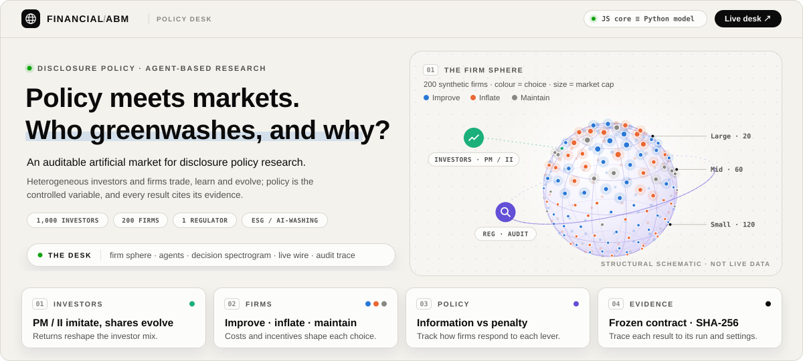

<p align="center"><strong>English (default)</strong> · <a href="README.zh-CN.md" lang="zh-CN">Simplified Chinese</a></p>

<p align="center">
  
</p>

<p align="center">
  <a href="https://github.com/kanzaler123/financial-ABM/actions/workflows/tests.yml"></a>
  <a href="https://github.com/kanzaler123/financial-ABM/actions/workflows/showcase.yml"></a>
</p>

<p align="center">
  <b>Turn a regulator's dial and watch 200 firms decide: improve for real, or greenwash?</b><br>
  An open-source artificial market for studying how investor preferences, firm decisions and regulatory policies shape ESG disclosure.
</p>

<p align="center">
  <b>Paper:</b> <i>Greenwashing Moves to Where Enforcement Is Weakest: Pre-Registered Experiments in an Artificial Market</i>, Ellis Lin (2026).<br>
  <a href="https://papers.ssrn.com/sol3/papers.cfm?abstract_id=7640081">SSRN Working Paper</a> · <a href="paper/README.md">Figure &amp; Statistic Reproduction</a>
</p>

<p align="center"><a href="https://papers.ssrn.com/sol3/papers.cfm?abstract_id=7640081"><b>Read the paper (SSRN)</b></a> · <a href="https://kanzaler123.github.io/financial-ABM/"><b>Try the live policy desk</b></a> · <a href="#quick-start"><b>Run it locally</b></a> · <a href="#what-we-found"><b>What we found</b></a> · <a href="#calibration-status"><b>Research status</b></a> · <a href="CONTRIBUTING.md"><b>Contribute</b></a></p>

<p align="center">
  <a href="https://kanzaler123.github.io/financial-ABM/"></a><br>
  <sub>Transparency rises from 0.10 to 0.70; orange firms (greenwashing) thin out and vanish near the threshold. Simplified replay in the browser, not a research result. <a href="https://kanzaler123.github.io/financial-ABM/">Open it and move the levers yourself.</a></sub>
</p>

## Project map

| Component | What it does | Start here |
|---|---|---|
| **Disclosure research model** | Runs multi-asset Python experiments with investors, firms, audits and assurance providers | [Quick start](#quick-start) · [Model source](src/abm/disclosure/) |
| **Browser policy desk** | Explains firm decisions, replays simplified dynamics, and explores archived Stage F & §§29–32 MAS mechanism results (Panels ①–④) | [Live desk](https://kanzaler123.github.io/financial-ABM/) · [Offline preview](#offline-policy-desk) |
| **Single-asset market application** | Provides the Stage 1–3 market, local web and desktop interfaces, and archived-run replay | [Local interfaces](#local-interfaces) · [Operating guide (Chinese)](OPERATIONS.md) |

The browser desk and the single-asset application's interfaces are separate tools. The full disclosure experiments run through the Python commands below. See [Documentation](#documentation) for research methods, evidence and operating references.

## What we found

**Greenwashing moves to where enforcement is weakest.** This is the main result of the [paper](https://papers.ssrn.com/sol3/papers.cfm?abstract_id=7640081), from pre-registered experiments and conditional on the model's assumptions. Sources: stage F (1,770 simulated markets), stages E.1 (450) and E.2 (540), and the joint robustness test (720). Each enforcement gap below is a place where greenwashing goes:

- **Large firms, under a capped fine (stage F).** With a fixed fine at the Securities Law cap for false disclosure (CNY 10 million per case, Art. 197(2)), used as a benchmark without a view on whether it applies to ESG reports, 66% of large firms' decisions are greenwashing, against 6% for small firms. The gap comes from the cap being negligible next to a large market cap, not from improvement costing large firms more.
- **Cases already open, when each case is fined once (stage F).** Going from no fine to that fine cuts the share of greenwashing decisions from 91% to 22%, but eight times that fine still leaves 12.5%, because a firm adds new inflation to an undetected case and faces no new fine. Fining every false report separately cuts it to 0.8% at the 8× fine.
- **Small firms and small jumps, when firms know the audit rule (stage E.1).** At the same expected number of audits, auditing in proportion to market value moves greenwashing from large to small firms and lowers the equal-weighted true ESG level by 0.19 SD relative to random audits. Auditing firms whose scores jump lowers it by 0.14 SD, because firms keep new inflation below the jump threshold. With the rule hidden, neither rule differs significantly from random audits. Neither rule was optimised.
- **The laxest assurance provider, when firms choose (stage E.2).** With strong provider liability (16×) and assurance mandatory for all firms, letting firms choose their provider removes most of the gain from random assignment (−0.20 SD against assignment). Counted by decisions, 96.9% of assured firms' greenwashing decisions were made by clients of that year's lowest-quality provider.

Two further results frame this:

- **Transparency is harder to route around, but how much it adds depends on how long real improvement lasts (stage F and the joint robustness test).** At the doses tested, raising transparency from 0.1 to 0.6 raises the true level more than quadrupling the fixed fine; the doses are not matched on cost. This ordering held at both ends of natural decay (0 and 0.2 SD/year), under mean reversion of true levels, and in all four settings of the pre-registered joint test, but its size did not: +0.21 SD at 0.2 SD/year of decay, +0.035 SD without decay, and only +0.003 to +0.012 SD under mean reversion (two speeds used as sensitivity values, not estimates). With a common washing cost and lasting improvement, greenwashing stops above transparency ≈ 0.57; with costs that differ across firms, it falls step by step.
- **With the original financing contract, nothing works without investors who care (stage F).** Without impact investors' taste for reported ESG, firms neither improve nor greenwash, and none of the policies has any effect, because a firm's financing rate then responds to its rating only through its share price. If lenders priced the rating directly (stage I), firms would still have a financing incentive; we have not run that case. In our sample, fund ownership and the implied cost of equity do respond to Huazheng ratings, less strongly than the model's investors do under policy (stage J).

Numbers, intervals and caveats are in [Stage F findings](#stage-f-findings), [Targeted audits](#targeted-audits-stage-e1) and [Assurance providers](#assurance-providers-stage-e2) below, and in the [paper](https://papers.ssrn.com/sol3/papers.cfm?abstract_id=7640081).

> [!NOTE]
> **Research status and release sync (`v0.4.0`, 28 November 2026).** All core studies (executed through commit `6f740df`, preserved byte for byte under `reports/`) and seven pre-registered MAS mechanism-design upgrade studies (contract §§29–32, commits `ff10f5b` and `6144298`, 2,250 confirmatory runs on disjoint seeds `71001–77030`, 40/41 primary Holm-corrected hypotheses supported and 1 honestly unresolved; archived under [`reports/disclosure_mas_upgrade_20261125/`](reports/disclosure_mas_upgrade_20261125/README.md)) are complete and audited. Release `v0.4.0` adds interactive **Panel ④** (`§§29–32`) to the [live policy desk](https://kanzaler123.github.io/financial-ABM/), removes the optional `scipy` runtime requirement from core `abm.disclosure`, accelerates `marginal_signal_value()`, and adds backward-compatible support for quantitative risk-band rate announcements (`audit_band_rates_public`) and joint targeted/Stackelberg audits with third-party assurance. Manuscript sources (11 deterministically reproduced figures in [`paper/`](paper/README.md), Propositions 1–6 in [`docs/disclosure_dynamic_propositions.md`](docs/disclosure_dynamic_propositions.md)) are maintained separately from this public code and evidence repository; the SSRN posting reflects an earlier working-paper version pending update.

## Calibration status

**Policy directions and effect sizes need separate judgments.** The [H2 estimation](reports/disclosure_persistence_estimation_20261026/README.md) rejected all three tested rating-dynamics forms. The closest form, Q, also failed the pre-specified parameter-recovery check. The [H3 rerun](reports/disclosure_stage_h3_20261027/README.md) retained the main directions but substantially reduced several effects. These are archived point estimates, not recomputations with the repaired code:

| Contrast: equal-weighted true change | Original stage F setting | H3: closest tested dynamics (Q; fit rejected) | H3: improvements permanent |
|---|---:|---:|---:|
| Information minus penalty | +0.205 SD | +0.003 SD | +0.077 SD |
| Penalty minus baseline | +0.125 SD | +0.014 SD | +0.021 SD |
| Information minus baseline | +0.331 SD | +0.017 SD | +0.097 SD |

The persistence of deliberate improvement is not identified by the rating panel. The original experiments' policy doses are not matched on implementation cost. The [stage I report](reports/disclosure_stage_i_20261027/README.md) finds that matching the in-sample financing association disrupts rating persistence; the [stage J report](reports/disclosure_investor_response_20261028/README.md) finds stronger model investor responses than the measured counterparts, with observation-window differences still to resolve. Joint empirical calibration remains open. The auxiliary H2/I3 profile intervals must be recomputed using the corrected objective minimum before being used to quantify identification uncertainty.

The multi-asset market conserves cash and shares but allows the market maker's cash to become negative; it does not impose a market-maker borrowing limit. Conservation checks therefore do not establish counterparty solvency or validate liquidity-crisis predictions.

## Quick start

**No install:** open the [live policy desk](https://kanzaler123.github.io/financial-ABM/), move a lever, then use **Copy a link to this policy** to share exactly what you see.

**Run the model** with Python 3.12 or newer. First, clone the repository and create an environment:

```sh
git clone https://github.com/kanzaler123/financial-ABM.git
cd financial-ABM
python -m venv .venv
```

Activate that environment using the command for your shell:

| Shell | Command |
|---|---|
| macOS / Linux | `source .venv/bin/activate` |
| Windows PowerShell | `.\.venv\Scripts\Activate.ps1` |
| Windows Command Prompt | `.venv\Scripts\activate.bat` |

Then install the experiment dependencies and run the public example from the repository root:

```sh
python -m pip install -c requirements-lock.txt -e ".[plot,research]"
python -m abm.disclosure.experiments --spec configs/disclosure_quickstart_v1.json --output runs/quickstart --workers 2
```

The run takes about 10–30 seconds: three policies (baseline, transparency 0.6, a proportional fine) on a small market of 40 firms and 4 seeds. Open `runs/quickstart/report.md` for paired contrasts with intervals and `policy_effects.png` for the chart.

Inspect **Trials failing core validation** as well as **Completed trials**. Completion can include price-guard hits; these are retained in the development example and must not be read as empirical validation.

**Change one thing and see it move.** In [`configs/disclosure_quickstart_v1.json`](configs/disclosure_quickstart_v1.json), set scenario `I` to `"transparency": 0.3` and run again with `--output runs/quickstart_tau03`. Transparency is now below the threshold: the information policy's gain over baseline falls from about +0.37 SD to about +0.07 SD, and the fine now does better. The quickstart uses the bundled, uncalibrated ESG domain at small scale, so it demonstrates the pipeline; it does not reproduce stage F.

Developers: `python -m pip install -c requirements-lock.txt -e ".[all,dev]"` then `python -m pytest`. The [contribution guide](CONTRIBUTING.md) explains the research rules and optional dependency groups. For the single-asset Stage 1–3 web and desktop application, see [Local interfaces](#local-interfaces).

For the empirical estimation scripts, install `python -m pip install -c requirements-lock.txt -e ".[empirical]"`; this includes pandas and openpyxl. Licensed inputs remain separate. Public mechanism tests use synthetic data and do not require those inputs. See the [correction workflow](docs/review_corrections_20261116.md) to recompute H2/I3 auxiliary intervals and H3 equal-budget contrasts into new outputs.

## Build on it

- **A new domain is a JSON file.** The disclosure game, a true attribute versus a reported one, is not specific to ESG: copy [`configs/domains/esg.json`](configs/domains/esg.json) and model carbon claims, earnings management or AI-washing.
- **A new policy experiment is a spec.** Copy the quickstart spec, add scenarios and paired comparisons, and the runner reports intervals.
- **Start small.** [CONTRIBUTING.md](CONTRIBUTING.md) explains the setup, the research rules and where to begin; issues labelled [`good first issue`](https://github.com/kanzaler123/financial-ABM/labels/good%20first%20issue) are scoped for newcomers.
- **Cite it:** for the results, the paper: Lin, E. (2026), *Greenwashing Moves to Where Enforcement Is Weakest: Pre-Registered Experiments in an Artificial Market*, [SSRN](https://papers.ssrn.com/sol3/papers.cfm?abstract_id=7640081); for the code, [CITATION.cff](CITATION.cff).

## Local interfaces

The web and desktop interfaces run the **Stage 1–3 single-asset market**. Use the disclosure experiment command in [Quick start](#quick-start) for the multi-asset policy study. Run the following commands from the repository root with your virtual environment activated.

### Web interface

Requires Node.js 22.12 or newer:

```sh
python -m pip install -c requirements-lock.txt -e ".[plot,web]"
cd web
npm ci
npm run build
cd ..
python -m abm.web --open
```

The service opens at `http://127.0.0.1:8765`. Select a configuration and a new run name in the interface; completed runs are saved under `runs/`. Use the **EN** button for the English interface.

### Desktop interface

Start a live run using the bundled Stage 2 configuration:

```sh
python -m pip install -c requirements-lock.txt -e ".[plot,desktop]"
python -m abm.desktop --mode live --config configs/stage2.json --run-dir runs/stage2_live
```

After the run completes, replay its saved events:

```sh
python -m abm.desktop --mode replay --run-dir runs/stage2_live
```

Use a new output directory for each live run. Replay reads an existing archive. The [operating guide (Chinese)](OPERATIONS.md) covers batch runs, configuration and reproduction in more detail.

### Offline policy desk

The static policy desk uses committed assets and evidence and needs no model dependencies:

```sh
python showcase/build.py --output _site
python -m http.server 8080 --bind 127.0.0.1 --directory _site
```

Open `http://127.0.0.1:8080`. The default language is English, with a separate Chinese option. The market-foundation exhibit is at `/stage1/`.

## The question

This project asks how firms choose between real improvement and greenwashing, and how investor preferences, financing incentives and regulation change that choice.

The method is an artificial financial market in which heterogeneous investors and firms interact, with policy settings varied in controlled comparisons. Its conclusions depend on the model's assumptions. The central question is:

> **Under joint pressure from policy and markets, how efficient is the ESG transition, and what path does it take?**

1. **Which policy works better?** Information policies (transparency) versus enforcement policies (fines), compared at doses fixed in advance: transparency raised from 0.1 to 0.6, and the fixed fine raised from CNY 10 million to 4×, each with its own dose ladder. The doses are not matched on expected fine or implementation cost, so the comparison is a ranking at these doses, not which policy is better at equal cost.
2. **How strong is the market's own engine?** Can impact investors drive a transition by “voting with their feet”? Do policies amplify or replace that force?
3. **Do large and small firms differ?** Is there an “ESG divide” in how fast norms spread by firm size?
4. **When does the market fall into a greenwashing trap?** Phase diagrams separating transition success, failure and greenwashing traps.

## Agents

| Agent | Count | Behaviour |
|---|---|---|
| **Profit-maximizing investors (PM)** | part of 1,000 investors | Mean–variance allocation; ESG has no utility value |
| **Impact investors (II)** | part of 1,000 investors | Utility includes a taste for *reported* ESG. Investors imitate the better-performing type each quarter, so the II share evolves |
| **Firms** | 200, in large / mid / small tiers | Each period: **real improvement** (costly, delayed), **greenwashing** (cheap, fast, may be audited) or **maintain**. Main experiments use NPV decisions; the separate Q-learning mode has not passed acceptance |
| **Regulator** | 1 | Transparency, audit probability, fines and subsidies; policies can switch on any date |
| **Market maker and noise flow** | — | Multi-asset quasi order book with price impact, volatility-dependent depth, and daily cash and share conservation |

The disclosure game, a true attribute versus a reported attribute, is not specific to ESG. **A domain is a JSON file**; the core code contains no domain vocabulary, and a test enforces that. Bundled domains: [ESG](configs/domains/esg.json), [AI-washing](configs/domains/ai_washing.json), [WBA social](configs/domains/wba_social_2023.json).

**Game-theoretic benchmarks.** Inspection games, signaling games, evolutionary dynamics, restless multi-armed bandits and Stackelberg leadership provide formal theoretical benchmarks ([Propositions 1–2](docs/disclosure_inspection_propositions.md) and [Propositions 3–6](docs/disclosure_dynamic_propositions.md)). Alongside continuous NPV firms, a zero-leakage online empirical-belief learner (`EmpiricalBeliefLearner`) tests behavioural robustness without reading post-switch policy parameters, and a purely public joint type–state Bayesian dynamic Stackelberg auditor (`BayesianAuditFilter`) contrasts optimal dynamic commitment against canonical heuristics. As of `v0.4.0`, the disclosure engine also supports quantitative risk-band rate announcements (`audit_band_rates_public`) for bounded learners and joint non-jump targeted/Stackelberg audits combined with strategic third-party assurance.

## Stage F findings

> Confirmatory experiment (2026-10-15): 59 scenarios × 30 paired seeds (41001–41030), 1,770 worlds at contract scale (1,000 investors, 200 firms, 3,500 trading days). The design, seeds and primary questions were written into the [research contract, §20](docs/disclosure_research_contract.md) and committed before the run (`2b08f65`). Firms use the continuous NPV rule. Every conclusion is conditional on the model's assumptions.

1. **Robust ordering: information > penalty > baseline.** This is a ranking at the tested doses (transparency 0.6 against a 4× fixed fine), which are not matched on expected fine or implementation cost; it does not mean information policy is better at equal cost. It holds at both ends of natural decay (0 and 0.2 SD/year), under both initialization controls and under the “equal cost” control, in which firms’ improvement cost does not vary with size. Exploratory checks run after stage F ([robustness report (Chinese)](reports/disclosure_robustness_20261018/README.md)) find the same ordering under mean reversion of true levels, one fixed fine per false report, and wash costs that differ across firms; under mean reversion, however, information beats penalty by only +0.003 to +0.006 SD. A pre-registered confirmatory test on new seeds ([joint robustness report (Chinese)](reports/disclosure_joint_robustness_20261023/README.md), contract §24) changed mean reversion and per-report fines together, with and without firm-specific wash costs: the ordering held in all four settings (all eight Holm-corrected contrasts were positive), but information beat penalty by only +0.004 to +0.012 SD, the same order as under mean reversion alone.
2. **Magnitudes are a range.** Over the policy window (days 1200–3500), the information policy raises the true level over baseline by +0.04 to +0.33 SD, the penalty policy by +0.005 to +0.13 SD, and information beats penalty by +0.035 to +0.21 SD. The ends correspond to a natural decay of 0 and 0.2 SD/year without effort. That parameter was uncalibrated in stage F. Stage H subsequently estimated rating dynamics and reran the policy contrasts, but all tested dynamics were rejected; see [Calibration status](#calibration-status). The range covers uniform decay only: under mean reversion at two speeds suggested by the then-unverified Huazheng panel, used as sensitivity values rather than estimates or bounds, information beats baseline by +0.02 to +0.03 SD and penalty by close to 0, both below the lower end. With one fine per false report added, information beats baseline by +0.04 to +0.06 SD and penalty by +0.004 to +0.012 SD. Items 3–6 below exist only for the main setting (0.2 SD/year), so their magnitudes are the upper end.
3. **Policy works only through market preference.** Impact investors' preference raises the full 14-year true level by +0.79 SD [+0.74, +0.85]. Without it, firms neither improve nor greenwash, and none of the three policies has any effect. This holds for the financing contract of stage F, in which the financing rate responds to the rating only through the share price; with a direct rating channel in the debt rate (stage I), the financing incentive no longer depends on investor taste.
4. **Transparency has a threshold.** When every firm has the same wash cost and real improvement lasts, greenwashing decisions stop entirely above τ* ≈ 0.57 and fines no longer matter; Proposition 2's threshold prediction held in all 16 grid cells. Undetected inflation accumulated before the switch does not disappear by itself. When wash costs differ across firms, each firm has its own threshold and greenwashing falls step by step with transparency (still 7% of decisions at 0.6); when true levels revert to the mean, the threshold rises to about 0.8.
5. **Fixed fines have diminishing marginal deterrence.** Going from no fine to CNY 10 million cuts the share of greenwashing decisions from 91% to 22%; under one fine per detected case, doubling, quadrupling and multiplying it by eight only reaches 16%, 13% and 13%, because a firm with an undetected case adds new inflation to that case and faces no new fixed fine. If every false report is fined separately, the 8× fine cuts the share to 0.8%; each doubling still adds less than the one before.
6. **The size gap comes from greenwashing, not costs.** Under the baseline policy, 66% of large firms' decisions are greenwashing against 6% for small firms, and large firms improve 0.33 SD less: a CNY 10 million fine is negligible against a large market cap. A proportional fine removes the size gradient (large firms greenwashing more than small ones), not greenwashing itself: under a 1× proportional fine, 72% of large firms’ decisions are still greenwashing, against 88% for small firms and 84% overall. At the equal-amount reference it is far weaker overall than the fixed fine (−0.34 SD).

**Limits.** Only NPV firms: the learning firms did not pass stage D, in the pre-registered redo either ([below](#learning-firms-stage-d3)). Audits are random at a fixed intensity; targeted audits and assurance providers are tested in stages [E.1](#targeted-audits-stage-e1) and [E.2](#assurance-providers-stage-e2) below. The implementation costs of policy are not modelled. 37 runs hit the price cap; they stay in the statistics, and excluding them changes nothing. Full tables: [stage F report (Chinese)](reports/disclosure_stage_f_20261014/README.md).

**In-browser policy desk.** [`showcase/`](showcase/README.md) brings the firm decision layer and confirmatory research archives into the browser. The home page opens in English (one click switches to Chinese) on a light policy desk: key stage F results and a live wire across the top, policy levers on the left, a firm sphere of the 200 synthetic firms in the middle, a decision ticket for one firm on the right, and below them agent cards (regulator, firm size classes, investors, the threshold τ*), a decision spectrogram and an audit trace. The desk replays panel ②, a 14-year simplified dynamic without market feedback, and is labelled as not a research result. Further down, panel ① shows how the 200 firms would choose this period under the selected policy, panel ③ shows the stage F results above with their sources, and **panel ④ (`MAS mechanisms §§29–32`)** lets readers explore all 7 SHA-256-verified MAS upgrade studies (2,250 runs, 40/41 Holm-corrected contrasts across Stackelberg commitment & granularity, assurance hysteresis $\gamma$ vs statutory floor $a_{\min}$ Pareto sweeps, bounded empirical learning spillovers, and Q-learning / AI-washing replication with a clean-seed $n=15$ sensitivity toggle). The decision rule matches the Python model term by term (1,200 random inputs, relative error at most 10⁻¹²), and the page states how far the simplified dynamics are from the full model. An AI-washing switch shows the same mechanism in another domain. The page address carries the policy and the selected firm, so a copied link reopens the same desk. The stage 1 exhibit (`stage1/`) uses the same light style. Live: [https://kanzaler123.github.io/financial-ABM/](https://kanzaler123.github.io/financial-ABM/); to preview locally: `python showcase/build.py --output _site`, then open `_site/index.html`.

<details>
<summary><b>Early diagnostics (before stage B)</b></summary>

**[Fact]** checked against primary sources · **[Diagnosis]** reproducible analysis of model behaviour · **[Dev]** small-scale, few-seed observation · **[Open]** identified but unresolved

- **[Fact] Statutory fines barely register for large Chinese firms.** China's Securities Law (Art. 197(2)) caps fines for false disclosure at CNY 10 million, about 0.01% of the median CSI 300 market cap. The 2024 exchange sustainability-reporting guidelines provide only disciplinary measures, with no fines. Whether greenwashing in ESG reports falls under Art. 197 is unclear. [Evidence table](docs/disclosure_empirical_magnitudes_20261012.md)
- **[Diagnosis] Our firms never greenwashed, and we found out why.** In the development runs, the expected fine was 14.5× the gross gain from washing (median). Mapped to real magnitudes, the model's fine was about 50× the legal cap and the financing benefit 10–30× too small. Without the fine, washing beats real improvement in every recorded decision. [Diagnosis](reports/disclosure_wash_diagnosis_20261012/README.md)
- **[Diagnosis] The transparency threshold is all-or-nothing.** With no fine, every firm washes below transparency ≈ 0.565 and none does above it, a consequence of homogeneous discounting and timing that the formal design must address. Later tested (contract 20.21, group W): with wash costs that differ across firms, the decline becomes gradual.
- **[Dev] Impact investors push real improvement.** Across three initialization settings, the market-preference effect is positive: about +1.7 to +2.5 score points over the measurement window (3 seeds, wide intervals).
- **[Diagnosis, fixed in stage C] With zero taste the impact-investor share still rose, because of the imitation rule.** The rule lacked the random draw of a comparison partner; with Schlag's original rule there is no drift at zero taste. [Stage C report (Chinese)](reports/disclosure_imitation_diagnosis_20261013/README.md)

</details>

## Targeted audits (stage E.1)

> Confirmatory experiment (2026-10-20), pre-registered in the [research contract, §21](docs/disclosure_research_contract.md) and committed before implementation and runs (`962d1ee`): 15 scenarios × 30 new paired seeds (42001–42030), 450 worlds, all completed. Every targeted rule keeps the expected number of audits equal to random audits at 1% per period. Firms use the continuous NPV rule. Full tables: [stage E.1 report (Chinese)](reports/disclosure_targeted_audits_20261020/README.md).

- **Targeted audits lower the equal-weighted true level relative to random audits when firms know the rule.** Auditing in proportion to market value: −0.191 SD [−0.222, −0.159]; auditing firms whose reports jump: −0.136 SD [−0.156, −0.116]. Both rules find inflation more often than random audits (50% and 69% of audits, against 28%).
- **Value targeting moves greenwashing from large to small firms.** Large firms' greenwashing share falls from 64% to 47% and small firms' rises from 5% to 35%. The value-weighted true level rises (+0.053 SD), but small firms are 60% of firms, so the equal-weighted level falls.
- **The damage comes from firms knowing the rule.** With the rule hidden, neither rule differs significantly from random audits (−0.005 SD each; the intervals include 0, which does not establish equivalence). Publishing the jump rule costs 0.131 SD: firms keep new inflation below the threshold.
- **Auditing more works where auditing differently does not.** Doubling random audits raises the true level by +0.118 SD. Information still beats value targeting combined with a 4× fine, by +0.156 SD.
- All five of this experiment's primary questions are supported (Holm p ≤ 1.1 × 10⁻¹¹); this does not by itself validate every mechanism described above. The magnitudes are for the main setting (0.2 SD/year of decay); without decay every effect is small and keeps its sign. Only the two rules tested were compared; no rule was optimised.

## Assurance providers (stage E.2)

**Archived results (v1 protocol, commit `6f740df`).** The numbers below are the preserved pre-registered outputs reported in the [paper](https://papers.ssrn.com/sol3/papers.cfm?abstract_id=7640081). The [16 November 2026 corrections](docs/review_corrections_20261116.md#4-implementation-corrections-and-reproducibility) (`7cdb384`) subsequently separated firm fees from provider effort in cost ledgers and moved check draws onto a calendar-day stream (`independent_assignment_and_calendar_checks_v2`) for future runs. None of the paper's assurance tables use cost-efficiency ratios (fees already entered firm values after each check), and all five primary contrasts compare either one assured scenario against an unassured baseline or two scenarios with identical 200-firm scope and start date; rerunning under v2 would require the non-redistributed vendor CSI 300 domain file.

> Confirmatory experiment (2026-10-21), pre-registered in the [research contract, §22](docs/disclosure_research_contract.md) and committed before implementation and runs (`307168c`): 18 scenarios × 30 new paired seeds (43001–43030), 540 worlds, all completed. Four strategic providers inspect clients' reports before publication and correct the inflation they find; each sets its quality once a year as a best response to its liability, which it pays when the regulator later catches inflation in a report it inspected. Liability doses are multiples of a CNY 5 million benchmark, the upper limit of the band for providers with no or low business income in Securities Law Art. 213(3); the model assumes the provision applies to ESG assurance and makes no judgement on whether it does. Fees and effort costs are assumptions. Intervals are paired 95% intervals not adjusted for multiple comparisons; the Holm correction applies to the p-values of the five primary questions. Full tables: [stage E.2 report (Chinese)](reports/disclosure_assurance_20261021/README.md).

- **Strong liability and assigned providers work.** With 16× liability and providers assigned at random: +0.273 SD [+0.234, +0.312] over no assurance; greenwashing decisions fall from 19.0% to 6.2%.
- **Letting firms choose their provider undoes most of the gain from assignment.** −0.199 SD [−0.233, −0.165] against assignment; in scenario means it stays about 0.07 SD above no assurance. Greenwashing returns to 21.0% of decisions. Counted by decisions, 96.9% of assured firms' greenwashing decisions were made by clients of that year's lowest-quality provider.
- **At the benchmark liability (1×) the effect is small.** +0.046 SD [+0.035, +0.058]. Average provider quality is only 0.014, low enough to act as insurance against fines: among firms with no undetected inflation when they decide, the share of decisions that greenwash is 0.9 percentage points higher. The true-level change nevertheless improves relative to the baseline because improvements are larger, a decomposition made after the results whose mechanism was not tested separately.
- **Among the doses tested, 16× helps most and 100× less.** Against no assurance: 1× +0.046, 4× +0.145, 10× +0.256, 16× +0.273, 100× +0.232 SD; no dose between 16× and 100× was run. Under 16×, mean quality first rises above the level that stops greenwashing and later falls back in 28 of 30 seeds, and greenwashing persists into the last four years in all 30.
- **Mandating only large firms narrows the size gap but pushes greenwashing to mid and small firms.** Large minus small +0.563 SD; equal-weighted only +0.057 SD.
- **Information still beats the assurance setting with the largest gain among those tested (ALL_R16),** by a small margin: +0.028 SD [+0.018, +0.038].
- **Nobody buys voluntary assurance,** because investors in the model see only reported scores and do not reward assurance. This follows from the model's assumptions; it is not a prediction. The model also publishes neither whether a firm is assured nor the provider's report, although the Shanghai Stock Exchange guidelines (Art. 58) require a firm that hires a provider to disclose them.
- All five of this experiment's primary questions are supported; this does not by itself validate every mechanism described above. The magnitudes are for the main setting (0.2 SD/year of decay); without decay every effect is small and keeps its sign (+0.030, −0.010, +0.004 and +0.009 SD for the counterparts of the first, second, third and sixth points). 29 runs triggered the price guard; as pre-registered they stay in the main analysis, and excluding them leaves all five primary verdicts unchanged.

## Learning firms (stage D.3)

> Confirmatory redo (2026-10-23), pre-registered in the [research contract, §23](docs/disclosure_research_contract.md) and committed before implementation and runs (`8bb5d9e`). Tabular Q-learning firms learn from their realised accounts: 10 independent trainings × 2 state versions (A: the stage D.2 state; V: the cost tier replaced by the firm's cumulative real improvement) × 4 scenarios (B, I, F, IF), compared with an NPV firm on the same action grid (discrete NPV). 540/540 jobs completed. Full tables: [stage D.3 report (Chinese)](reports/disclosure_learning_redo_20261021/README.md).

- **Stage D is still not accepted.** 91/100 tables pass the coverage test. All 9 failures are post-policy tables, 8 of them in the large-firm group.
- **Training randomness dominates.** Within a scenario, the greenwashing share differs 14–18 times more between independently trained tables than within one table across validation seeds, so a single table cannot answer a policy question.
- **A greenwashing trap, not learned profit (P1 supported).** Under the information policy, learning firms greenwash in 23.7% of decisions against 3.8% for discrete NPV: +19.9 percentage points, Holm p = 0.031. The extra greenwashing loses a median of about 0.042 basis points of market value per decision against the NPV choice, far below the reward noise. The learners cannot learn their way out of it; they have not learned that greenwashing pays. The other four primary questions (P2–P5) are unresolved.
- **Seeing improvement cuts greenwashing, not into improvement** (auxiliary, uncorrected). With the V state, pre-policy tables trained from scratch greenwash 34.7 percentage points less, but those decisions become “maintain”, and real improvement shows no significant increase.
- **Fragile, and outside the main conclusions.** Dropping the 5 replicates that contain a failing table leaves P1 unresolved too. Learning firms stay out of the stage F conclusions above.

## MAS theory & mechanism-design upgrades (contract §§29–32)

> Seven pre-registered confirmatory studies (2026-11-25 to 2026-11-26), frozen prior to execution (`ff10f5b`, `6144298`) on seven mutually disjoint 30-seed blocks (`71001–77030`, 2,250 confirmatory runs, 0 pre-switch parity mismatches across 2,010 checked pairs). **40/41 primary Holm-corrected hypotheses are `supported` and 1/41 (`G5`) is honestly `unresolved`; all 41 verdicts are invariant after excluding every seed with a market-layer `no_price_caps` clamp hit.** Formal proofs: [Propositions 3–6](docs/disclosure_dynamic_propositions.md). Reports & JSON audits: [§§29–31 report](reports/disclosure_mas_upgrade_20261125/README.md) · [§32 boundary report](reports/disclosure_mas_upgrade_20261125/README_sec32.md) · [analysis JSON](reports/disclosure_mas_upgrade_20261125/mas_upgrade_analysis.json).

- **Bayesian dynamic RMAB-Stackelberg audits (§29, 330 runs, 6/6 supported).** A 100%-public joint type–state Bayesian restless-bandit allocator (`BayesianAuditFilter`, upper-concave-envelope water-filling) reverses heuristic failure: history-only `S_obs` beats random `B` by `+0.120 SD`, value targeting `V` by `+0.313 SD`, jump targeting `J` by `+0.257 SD`, and unconfounded hidden Bayesian clearing `S_obs_hid` by `+0.128 SD` despite a `23.8%` vs `92.1%` hit-rate paradox; filtering public report changes (`S_obs_sig`) beats 2× random budget `A2` at 1× capacity (`+0.032 SD`) and captures `57.0%` of the full-information oracle gain.
- **Zero-leakage online empirical-belief bounded rationality (§30, 240 runs, 6/6 supported).** Beyond the L0 tabular Q-learning SNR barrier and L1 cross-sectional control-variate diagnosis (`>95%` idiosyncratic variance), `EmpiricalBeliefLearner` updates audit, fine and provider beliefs solely from realised events via discounted Beta–Binomial posteriors and Thompson sampling. Transparency (`+0.355 SD`), spontaneous cross-tier displacement under `V` (`+16.9 pp` small, `−19.3 pp` large), assurance escape (`−0.048 SD`, attenuated ~80% by bilateral learning lag) and runtime hysteresis (`+0.087 SD`, matching transparency) all hold; coarse-belief Stackelberg (`EB_S_obs − EB_B = −0.050 SD`) reveals its quantitative-communication cognitive boundary.
- **Partial-observability `50.5×` blindness & runtime remedies (§31, 450 runs, 6/6 supported).** When providers observe only their own corrections and regulatory citations (`detected_bayes`), reverse monitoring inertia preserves both high-liability 3-cycles and firm-choice escape (`q_gap = −0.0269`). Runtime scrutiny hysteresis (`γ = 0.7`) cures both pathologies simultaneously without banning firm choice (cutting washing `26.7% → 3.2%`, recovering `97.3%` of transparency); annual mandatory rotation (`ALL_ROT16_bayes`) likewise eliminates escape (`+0.259 SD`, `q_gap = 0.000`).
- **Institutional phase transition & Pareto frontier (§32B, 330 runs, 6/6 supported).** Hysteresis (`γ = 0.7`) lowers total firm-plus-verifier social resource cost by `−2.89 bp` (`5.55 → 2.66 bp`, a compliance free lunch). Statutory minimum floors exhibit a sharp phase transition across the analytical fine-insurance boundary `a_ins = 0.0346` (`m006 − m003 = +0.1125 SD`; `m015` reaches 0% washing) and save `73%–90%` verifier effort cost via Jensen's inequality when `a*` is known ex ante.
- **Communication granularity (§32C-1, 270 runs, 4/5 supported, 1 unresolved).** Incentive-compatible `G`-band public risk menus capture `62.8%` (`G=5`) and `72.0%` (`G=8`, 3 bits) of exact `S_obs` gain for forward-looking firms, whereas unquantified 2-band watchlist labels fail to rescue empirical-belief learners (`G5 = −0.012 SD`, Holm `p = 0.539`, `unresolved`).
- **Cross-regime & non-ESG domain generalization (§32A 360 runs, 0 failures, 6/6 supported; §32C-2 270 runs, 6/6 supported).** Under empirically estimated persistence `Q(0.505, 0.423)`, pure-history `Q_S_obs` overtakes transparency `Q_I` (`+0.012 SD`) and hysteresis delivers `>3×` transparency's gain, while noisy score filtering (`Q_S_obs_sig − Q_S_obs = −0.017 SD`) maps the high-noise (`σ_r = 0.351`) SNR boundary. In the non-ESG [`ai_washing`](configs/domains/ai_washing.json) domain, all six primary contrasts replicate identically across full `n = 30` and clean `n = 15` (excluding 15 seeds with high-taste `no_price_caps` hits), with hysteresis slashing washing from `57.6%` to `4.4%` and beating transparency by `+0.268 SD`.

## Financing premium (stage I)

> Pre-registered in the [research contract, §26](docs/disclosure_research_contract.md) (2026-10-27 to 10-28). The sample and specification were fixed before the estimate, which was run once; each revision of the model design was written into the contract and approved before it was implemented or run. The model runs use the rating persistence estimated on Huazheng ratings in stage H. Reports (Chinese): [estimate](reports/disclosure_financing_premium_20261027/README.md), [model](reports/disclosure_stage_i_20261027/README.md).

- **In our sample, higher-rated firms pay less for debt.** Among non-financial A-share firms (41,662 firm-years, 4,706 firms, 2009–2024), a one-SD higher Huazheng score goes with a debt cost 28.0 basis points lower in the following year [23.4, 32.5]. This is an association, not a causal effect. Within firms (firm fixed effects) it is 11.9 [7.4, 16.4]; for current CSI 300 constituents alone it is −0.6 [−15.8, +14.6], indistinguishable from zero. Bond issue spreads point the same way: 6.8 [2.4, 11.3].
- **The model's financing incentive is an order of magnitude smaller.** The local response of a firm's financing rate to its rating, the quantity firms decide on, is about 2.2 basis points per SD.
- **Matching the estimate breaks the model's rating dynamics.** Raising the spread of the financing contract made it unstable: 37 of 42 development runs at the target spread failed. A direct channel in which lenders price the rating (25.75 basis points per unit of the rating signal) reached the target and kept all 1,590 runs stable, but most firms then pushed their ratings close to the top of the scale. The rank autocorrelation of ratings at a one-quarter lag fell to 0.67, against 0.93 in the data, and re-estimating the natural dynamics under the channel found no form that fits. In this model, a financing premium of the estimated size is incompatible with the persistence of Huazheng ratings.
- **Under that channel the eight primary contrasts keep their sign, but where greenwashing goes barely changes.** All eight Holm-corrected primary questions are supported. 93.5% of baseline decisions are then greenwashing, against 21.4% without the channel. Small firms' share of all greenwashing decisions rises by 0.3 percentage points under value-targeted audits relative to the baseline, against 22.4 without the channel in the same run (uncorrected); the laxest provider's clients' share of assured firms' greenwashing decisions rises by 16.4 points when firms choose their provider rather than being assigned one, against 70.1.
- **So the main results keep the smaller financing incentive.** Their signs do not depend on it; their magnitudes do, and should not be extrapolated to an incentive that matches the sample.

## Investor response (stage J)

> Pre-registered in the [research contract, §27](docs/disclosure_research_contract.md) (2026-10-28 to 10-29). The samples and specifications were fixed before the estimate, which was run once; three primary questions, Holm-corrected. A change found before the estimate (forecasts restated to the June share count) was written into the contract and approved first. Report (Chinese): [investor response](reports/disclosure_investor_response_20261028/README.md).

- **Fund ownership and the cost of equity respond to Huazheng ratings; returns after an update show no statistically significant response.** Over the twelve updates from January 2023 to October 2025, a one-notch upgrade over the year goes with year-end fund ownership 0.12 percentage points of tradable shares higher [0.07, 0.17] (13,871 firm-years), and a one-SD higher score with an implied cost of equity (PEG, analyst forecasts) 14.5 basis points lower [3.0, 26.0] (6,160 firm-years of firms with at least two brokers). Returns in the two months after an update: +0.14 percentage points per notch [−0.17, +0.45]. These are associations, not causal effects.
- **On ratings that were not yet public, neither responds distinguishably from zero.** On ratings Huazheng back-calculated for 2009–2017: fund ownership +0.01 [−0.09, +0.12], cost of equity +3.0 [−4.7, +10.7]. The differences between the two periods are not statistically significant (+0.11 [−0.01, +0.22] and +11.5 [−2.4, +25.4]).
- **The fund-ownership result is fragile.** With the change in the normal score as treatment it is +0.07 [−0.02, +0.16] per SD, and without 2024, the year of Huazheng's method revision, +0.07 [−0.01, +0.14]. The cost-of-equity result holds in all three pre-registered variants (14.5 to 16.2 basis points).
- **The model's investors respond more strongly.** In the baseline of the stage H re-run, a one-SD change in the signal moves the price by 2.33 percentage points within a quarter, three times the upper end of the data's interval (+0.12 [−0.52, +0.77] per SD), and the slope of dividend yield on the signal is 32.4 basis points per SD over the policy window, 2.2 times the cost-of-equity estimate (25.6 before any policy, inside its interval). The calibration target, 28 basis points per SD from Zhao et al. (2024), lies just above the in-sample interval. We did not recalibrate the investor taste.
- **Not tested:** the holdings of ESG-themed funds, because fund-level holdings were not available to us.

## Roadmap

- [x] Single-asset market foundation (Stage 1): frozen v15 formal acceptance 22/22
- [x] Multi-asset market: 60 fixed worlds audited, 57 PASS / 3 FAIL (kept on record); order-flow replay reproduced 60/60 bit for bit
- [x] Empirical start: CSI 300 ESG scores, half-year book equity and market caps, 300/300 each
- [x] Greenwashing-condition diagnosis and evidence review
- [x] Firm game with capped lump-sum fines, plus two inspection-game propositions (stage B)
- [x] Investor evolution: imitation rule corrected against replicator dynamics (stage C)
- [x] Learning firms: compared, then redone with 10 independent trainings per scenario (stage D.3, 2026-10-23); coverage 91/100 tables, so they still do not pass acceptance and are excluded from the formal experiment (stage D)
- [x] New agents: risk-based regulator with targeted audits (stage E.1, 2026-10-20) and strategic assurance providers (stage E.2, 2026-10-21)
- [ ] Rating disagreement
- [x] Formal experiments: information vs enforcement, phase diagrams, size divide (fresh seeds, design frozen before running; stage F)
- [x] In-sample financing premium: debt cost 28.0 bp lower per SD of the Huazheng score (an association); matching it in the model makes ratings bunch at the top of the scale, so the main results keep the smaller incentive (stage I, 2026-10-28)
- [x] Investor response to Huazheng ratings: fund ownership and the cost of equity respond (14.5 bp per SD, about half the calibration target), returns show no statistically significant response; the model's investors respond more strongly, taste not recalibrated (stage J, 2026-10-29)
- [x] In-browser policy sandbox: [GitHub Pages](https://kanzaler123.github.io/financial-ABM/), v0.2.0 (2026-10-16); redesigned as a light policy desk, English first (2026-10-18); upgraded in v0.4.0 (2026-11-28) with interactive Panel ④ for §§29–32 MAS mechanism design
- [x] Joint robustness test: mean reversion of true levels and one fine per false report together, pre-registered on new seeds (contract §24, 2026-10-23)
- [x] Working paper: *Greenwashing Moves to Where Enforcement Is Weakest*, on [SSRN](https://papers.ssrn.com/sol3/papers.cfm?abstract_id=7640081) (earlier version of 24 October 2026); 11-figure reproduction package for the 26 November 2026 revision in [`paper/`](paper/README.md) (incorporating Propositions 1–6, stages H–J, review corrections §28, and MAS mechanism-design upgrades §§29–32)
- [x] MAS theory & mechanism-design upgrades (contract §§29–32, 2026-11-26): Propositions 3–6, Bayesian dynamic RMAB-Stackelberg audits + `G`-band communication menus, zero-leakage empirical-belief bounded rationality, partial-observability assurance hysteresis/floor Pareto frontier, `Q` persistence reversal, and non-ESG `ai_washing` generalization (2,250 confirmatory runs, 40/41 primary hypotheses supported, 1 unresolved `G5`)
- [x] Rating persistence estimated and key comparisons rerun (stage H); all tested forms rejected, recovery check failed, auxiliary profile intervals awaiting correction from the original archives
- [ ] Joint empirical calibration of rating persistence, financing incentives and investor responses; H/I/J analyses are completed, their fit limitations remain open
- [ ] Enforcement intensity, greenwashing proxies and cost parameters from data (stage K)
- [ ] Global sensitivity analysis (stage L)
- [ ] Pre-registered out-of-sample tests: the 2020 increase in Securities Law fines and the 2024 exchange sustainability-reporting guidelines (stage M)
- [ ] Policies compared at equal cost (stage N) and behavioural robustness (stage O)

## Research standards

Key settings are fixed in a [research contract](docs/disclosure_research_contract.md) before any policy experiment that uses them. Failures are kept, not deleted. Evidence directories are stored byte for byte, so the recorded SHA-256 values can be checked directly. Every empirical parameter cites its source and evidence level. Vendor data (Huazheng, Eastmoney and others) has no open redistribution licence and is not included; collection scripts and hash manifests are.

## Documentation

This README is the default English entry point. The [Simplified Chinese README](README.zh-CN.md) has its own text and cover. Research archives retain their original language; the language labels below identify those references before you open them.

| Reference | Language | Purpose |
|---|---|---|
| [Paper reproduction](paper/README.md) | English | Figure generation, descriptive statistics, and evidence provenance |
| [Review corrections](docs/review_corrections_20261116.md) | English | Statistical corrections, implementation changes and pending recomputations |
| [Contribution guide](CONTRIBUTING.md) | English, with a short Chinese summary | Development setup, research rules and contribution scope |
| [Research contract](docs/disclosure_research_contract.md) | Chinese, with an English correction addendum | Fixed designs, assumptions and acceptance criteria |
| [Documentation index](docs/README.md) | Primarily Chinese | Links to plans, technical notes and archived research |
| [Operating guide](OPERATIONS.md) | Chinese | Detailed instructions for the single-asset application |
| [Showcase maintenance](showcase/README.md) | Chinese | Static build, source data and visual assets |

---

<sub>Financial ABM · Research prototype. Inspectable mechanisms, traceable evidence. Not investment advice.</sub>
