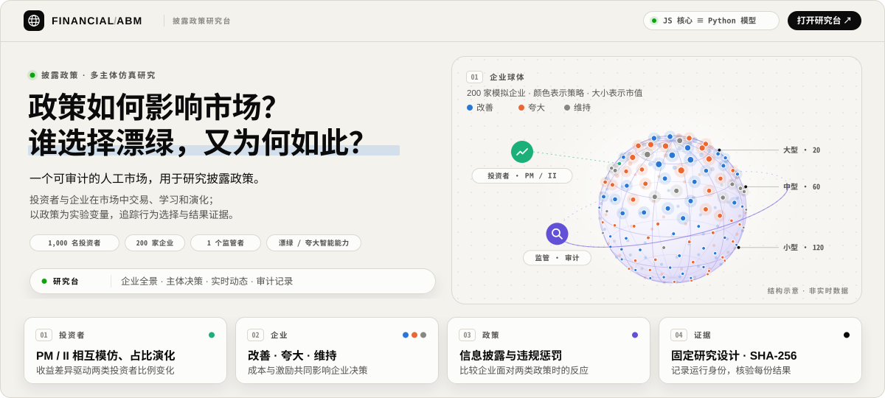
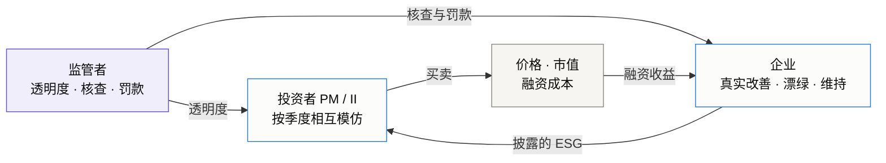

<p align="center"><a href="README.md" lang="en">English (default)</a> · <strong>简体中文</strong></p>

<p align="center">
  
</p>

<p align="center">
  <a href="https://github.com/kanzaler123/financial-ABM/actions/workflows/tests.yml"></a>
  <a href="https://github.com/kanzaler123/financial-ABM/actions/workflows/showcase.yml"></a>
</p>

<p align="center">
  <b>调一调监管旋钮，看 200 家企业怎么选：真实改善，还是漂绿？</b><br>
  一个开源的多智能体人工市场：投资者交易并相互模仿，企业选择真实改善、漂绿或维持，监管者按设定的规则介入，用来比较不同 ESG 政策下的模型行为。
</p>

<p align="center">
  <b>论文：</b><i>Greenwashing Moves to Where Enforcement Is Weakest: Pre-Registered Experiments in an Artificial Market</i>，Ellis Lin（2026）。<br>
  <a href="https://papers.ssrn.com/sol3/papers.cfm?abstract_id=7640081">SSRN 工作论文</a> · <a href="paper/README.md">图表与统计复现包</a>
</p>

<p align="center">
  <a href="https://papers.ssrn.com/sol3/papers.cfm?abstract_id=7640081"><b>阅读论文（SSRN）</b></a> ·
  <a href="https://kanzaler123.github.io/financial-ABM/"><b>在线试玩政策作战台</b></a> ·
  <a href="#快速开始"><b>本地跑起来</b></a> ·
  <a href="#主要发现"><b>主要发现</b></a> ·
  <a href="#校准状态"><b>校准状态</b></a> ·
  <a href="#导航"><b>文档导航</b></a> ·
  <a href="CONTRIBUTING.md"><b>参与贡献</b></a>
</p>

<p align="center">
  <a href="https://kanzaler123.github.io/financial-ABM/"></a><br>
  <sub>透明度从 0.10 提高到 0.70，橙色（漂绿）企业逐渐变少，接近门槛时消失。这是浏览器里的简化回放，不是研究结果。<a href="https://kanzaler123.github.io/financial-ABM/">打开页面，自己拖动杠杆。</a></sub>
</p>

## 主要发现

**漂绿会流向执法最弱的地方。** 这是[论文](https://papers.ssrn.com/sol3/papers.cfm?abstract_id=7640081)的主要结论，来自事先登记设计的实验，以模型假设为条件。来源：阶段 F（1770 个模拟市场）、阶段 E.1（450 个）与 E.2（540 个），以及联合稳健性检验（720 个）。下面每一处执法缺口，都是漂绿流向的地方：

- **流向大企业：罚款有上限时（阶段 F）。** 定额罚款取《证券法》对虚假披露的罚款上限（每案 1000 万元，第 197 条第二款），作为基准，不判断它是否适用于 ESG 报告；此时大企业 66% 的决策是漂绿，小企业为 6%。差距来自这个上限相对大市值微不足道，而不是大企业改善成本更高。
- **流向已有的未查出案件：一案只罚一次时（阶段 F）。** 从不罚款到这一罚款，漂绿决策占比从 91% 降到 22%，但罚款提高到 8 倍仍剩 12.5%，因为企业把新的虚报加到尚未查出的案件上，不会再被罚一次。改为每份虚假报告各罚一笔后，8 倍罚款下降到 0.8%。
- **流向小企业和小幅跳升：企业知道核查规则时（阶段 E.1）。** 在相同的期望核查次数下，按市值核查把漂绿从大企业挤到小企业，等权真实 ESG 水平比随机核查低 0.19 SD；按报告跳升核查低 0.14 SD，因为企业把新虚报压在跳升门槛之下。规则不公布时，两种定向规则与随机核查都未检出统计显著差异。两种规则都未经优化。
- **流向最宽松的鉴证方：企业自选鉴证方时（阶段 E.2）。** 在鉴证方责任强（16 倍）、全部企业强制鉴证时，让企业自选鉴证方抵消了随机指派带来的大部分改善（比指派低 0.20 SD）。按决策次数计，被鉴证企业的漂绿决策 96.9% 出自当年质量最低的鉴证方的客户。

另外两条结果划定了这个结论的范围：

- **透明度更难绕开，但它多带来多少改善，取决于真实改善能持续多久（阶段 F 与联合稳健性检验）。** 在测试剂量下，透明度从 0.1 提高到 0.6，比定额罚款提高到 4 倍更能提高真实水平；两者没有按成本匹配。这一排序在自然衰减两端（0 与每年 0.2 SD）、真实水平均值回归下，以及预注册联合检验的全部四个设定中都成立，但差距大小不稳健：每年 0.2 SD 衰减时为 +0.21 SD，无衰减时为 +0.035 SD，均值回归下只有 +0.003 到 +0.012 SD（两个回归速度是敏感性取值，不是估计值）。所有企业漂绿成本相同、真实改善持久时，透明度超过 ≈ 0.57 后漂绿停止；漂绿成本因企业而异时，漂绿随透明度提高逐步减少。
- **原融资合同下，没有 ESG 偏好就没有政策效应（阶段 F）。** 去掉影响力投资者对报告 ESG 的偏好，企业既不改善也不漂绿，所有政策都没有效果。这个结论适用于评级仅通过股价影响融资成本的原合同。阶段 I 加入贷款方直接按评级定价的渠道后，融资激励不再完全依赖投资者偏好；“直接评级渠道加零投资者偏好”的组合尚未运行。

数值、区间和限定条件见下文[阶段 F 发现](#阶段-f-发现)、[定向核查](#定向核查阶段-e1)与[鉴证机构](#鉴证机构阶段-e2)，以及[论文](https://papers.ssrn.com/sol3/papers.cfm?abstract_id=7640081)。

> [!NOTE]
> **研究状态与同步说明（2026 年 11 月 26 日）。** 基础研究（运行至提交 `6f740df`，`reports/` 下原始证据按字节保留）与七组全新预注册 MAS 机制设计升级确认性实验（契约第 29–32 节，冻结提交 `ff10f5b`、`6144298`，七段互不相交种子 `71001–77030`，共 2,250 次运行，**40/41 主假设获支持、1/41 `G5` 未定**；归档见 [`reports/disclosure_mas_upgrade_20261125/`](reports/disclosure_mas_upgrade_20261125/README.md)）已全部完成并核验。2026 年 11 月 26 日修订版工作论文（[`paper/`](paper/README.md) 可确定性复现全部 11 张图表；动态形式化命题见 [`docs/disclosure_dynamic_propositions.md`](docs/disclosure_dynamic_propositions.md)）完整整合了全部 14 项预注册研究及[2026 年 11 月 16 日审查修正说明](docs/review_corrections_20261116.md)（契约第 28 节）。论文源码与投稿草稿与本公开代码证据仓库分开维护；SSRN 将同步更新至 11 月 26 日修订版。

## 校准状态

**政策方向与效应量级需要分别判断。** [H2 估计](reports/disclosure_persistence_estimation_20261026/README.md) 中三种评级动态均被拟合检验拒绝，最接近数据的 Q 形式也未通过事先规定的参数恢复检验。[H3 重跑](reports/disclosure_stage_h3_20261027/README.md) 中主要方向保留，但部分效应显著缩小。下表是历史档案中的点估计，并非修复后代码的重算结果：

| 对比：等权真实变化 | 阶段 F 原主设定 | H3：最接近数据的候选 Q（拟合被拒绝） | H3：改善永久保留 |
|---|---:|---:|---:|
| 信息政策减罚款政策 | +0.205 SD | +0.003 SD | +0.077 SD |
| 罚款政策减基线 | +0.125 SD | +0.014 SD | +0.021 SD |
| 信息政策减基线 | +0.331 SD | +0.017 SD | +0.097 SD |

评级面板尚不能识别主动改善是否持久；原实验也没有按政策实施成本匹配剂量。[阶段 I](reports/disclosure_stage_i_20261027/README.md) 显示，对准样本融资关联会破坏评级持续性；[阶段 J](reports/disclosure_investor_response_20261028/README.md) 显示模型投资者反应更强，模型与数据的观测窗口仍需对齐。联合经验校准仍待完成。H2/I3 的辅助剖面区间必须用修正后的目标函数最小值重算，才能用于量化识别不确定性。

多资产市场检查现金与股份守恒，但允许做市商现金为负，未设置做市商借款上限。守恒检查因此不能证明交易对手具有偿付能力，也不能验证流动性危机预测。

## 快速开始

**不用安装：** 打开[在线政策作战台](https://kanzaler123.github.io/financial-ABM/)，拖动杠杆，再点 **复制当前政策的链接**，就能把你看到的结果原样分享出去。

**在本地跑模型**：需要 Python 3.12+ 和 Git。首次使用时，先克隆仓库并建立虚拟环境：

```sh
git clone https://github.com/kanzaler123/financial-ABM.git
cd financial-ABM
python -m venv .venv
```

根据使用的终端激活环境。

**macOS / Linux（bash 或 zsh）：**

```sh
source .venv/bin/activate
```

**Windows PowerShell：**

```powershell
.\.venv\Scripts\Activate.ps1
```

**Windows 命令提示符：**

```bat
.venv\Scripts\activate.bat
```

然后在仓库根目录安装依赖并运行示例：

```sh
python -m pip install -c requirements-lock.txt -e ".[plot,research]"
python -m abm.disclosure.experiments --spec configs/disclosure_quickstart_v1.json --output runs/quickstart --workers 2
```

运行约 10–30 秒：在 40 家企业、4 个种子的小市场上比较三种政策（基准、透明度 0.6、比例罚款）。结果在 `runs/quickstart/report.md`（带区间的配对对比）和 `policy_effects.png`。

同时检查报告中的**未通过核心校验的运行数**（`Trials failing core validation`）和**已完成的运行数**（`Completed trials`）。完成的运行仍可能触发价格截断；开发示例保留这些记录，不能把运行完成视为经验验证通过。

**改一个参数，看结果怎么变。** 把 [`configs/disclosure_quickstart_v1.json`](configs/disclosure_quickstart_v1.json) 中场景 `I` 的透明度改成 `"transparency": 0.3`，换一个输出目录 `--output runs/quickstart_tau03` 再跑一次。此时透明度低于门槛：信息政策相对基准的提升从约 +0.37 SD 降到约 +0.07 SD，罚款反而更有效。快速示例使用仓库自带、未经校准的 ESG 领域和小规模市场，用来演示流程，不复现阶段 F。

开发与测试：`python -m pip install -c requirements-lock.txt -e ".[plot,research,web,dev]"`，然后 `python -m pytest`。这组依赖不包含桌面界面；需要桌面界面和全部可选功能时，改为安装 `".[all,dev]"`。单资产主应用的界面和其他命令见下文[单资产主应用的本地界面](#单资产主应用的本地界面)和 [OPERATIONS.md](OPERATIONS.md)。

运行实证估计脚本还需 `python -m pip install -c requirements-lock.txt -e ".[empirical]"`，包含 pandas 和 openpyxl。授权数据单独准备；公开机制测试使用合成数据，不依赖这些输入。H2/I3 辅助区间与 H3 同预算对比的重算方法见[修正流程](docs/review_corrections_20261116.md)，输出应写入新目录。

## 在这个项目上做研究

- **换一个领域，只需一份 JSON。** “真实属性与披露属性”的信号博弈不只出现在 ESG 中：复制 [`configs/domains/esg.json`](configs/domains/esg.json)，就可以研究碳排放声明、盈余管理或 AI-washing。
- **新的政策实验是一份配置。** 复制快速示例的配置，增加场景和配对比较，运行器会输出带区间的报告。
- **从小处开始。** [CONTRIBUTING.md](CONTRIBUTING.md) 说明环境、研究规则和入手点；标记为 [`good first issue`](https://github.com/kanzaler123/financial-ABM/labels/good%20first%20issue) 的议题适合第一次参与。
- **引用**：引用结果请引论文：Lin, E. (2026), *Greenwashing Moves to Where Enforcement Is Weakest: Pre-Registered Experiments in an Artificial Market*，[SSRN](https://papers.ssrn.com/sol3/papers.cfm?abstract_id=7640081)；引用代码见 [CITATION.cff](CITATION.cff)。

## 研究问题

项目关注两个彼此关联的问题：企业如何在真实改善与漂绿之间选择，以及投资者偏好、融资激励和监管政策怎样改变这一选择。

研究方法是构建人工金融市场，让异质的投资者和企业互动，把政策作为可控变量进行反事实比较。结论以具体模型设定为条件，核心问题是：

> **在政策与市场的双轮驱动下，ESG 转型的效率和路径是怎样的？**

1. **哪种政策更有效？** 提高透明度的“信息型”政策，与提高违规成本的“惩罚型”政策，在事先固定的剂量下比较：透明度从 0.1 提高到 0.6，定额罚款从 1000 万元提高到 4 倍，另有各自的剂量梯度。两种剂量没有按期望罚金或实施成本匹配，所以比较的是这些剂量下的排序，不是同等成本下哪种政策更优。
2. **市场自身的动力有多大？** 在没有外部干预时，影响力投资者能否通过“用脚投票”自发推动转型？政策是放大还是替代了这股力量？
3. **大企业和小企业有什么不同？** ESG 规范在不同规模企业之间的传导速度，是否存在“ESG 鸿沟”？
4. **什么时候会陷入漂绿陷阱？** 在参数空间中画出相图，区分“转型成功”“转型失败”和“漂绿陷阱”。

## 多智能体设计



| 参与者 | 规模 | 行为 |
|---|---|---|
| **利润导向投资者（PM）** | 1000 名投资者中的一部分 | 均值—方差配置，ESG 不进入效用 |
| **影响力投资者（II）** | 同上 | 效用中加入对披露 ESG 的偏好；两类投资者按相对业绩相互模仿，占比随时间演化 |
| **企业** | 200 家，分大、中、小三档 | 每个决策期在“真实改善 / 漂绿 / 维持”中选择：真实改善昂贵且有实施延迟；漂绿便宜、见效快，但可能被核查发现。主结论使用 NPV 理性决策；另有 Q-learning 学习模式，其验收尚未通过 |
| **监管者** | 1 | 设定透明度、核查概率、罚款和补贴，政策可以在任意日期切换 |
| **做市商与噪声交易** | — | 多资产准订单簿：价格冲击、随波动变薄的深度，现金与股份逐日守恒 |

**领域可以替换。** “真实属性与披露属性”的信号博弈不只出现在 ESG 中。领域只是一份 JSON 配置，核心代码中不出现任何领域词汇，由测试强制检查。仓库内置 [ESG](configs/domains/esg.json)、[AI-washing](configs/domains/ai_washing.json)、[WBA 社会维度](configs/domains/wba_social_2023.json) 三个领域。

### 博弈论视角

这些经典博弈为模型提供理论参照，用来分析企业激励、投资者演化和监管规则的后果。主实验采用 NPV 企业，学习型企业另作验收；定向核查实验比较预先设定的规则，没有求解监管者的最优政策。

| 层面 | 博弈 | 仿真检验什么 |
|---|---|---|
| 企业与监管者 | 检查博弈 | 罚款、核查与透明度的闭式漂绿条件，加入市场反馈后是否仍然成立 |
| 企业与投资者 | 信号博弈 | “漂绿陷阱”是否就是混同均衡；透明度和鉴证能否推向分离均衡 |
| 投资者群体 | 演化博弈（复制动态） | 影响力投资的扩张来自“选择”还是“漂移” |
| 监管者 | 斯塔克伯格博弈 | 定向核查与随机核查的比较 |

## 阶段 F 发现

> 确认性实验（2026-10-15）：59 个场景 × 30 个配对种子（41001–41030），共 1770 个契约规模的世界（1000 名投资者、200 家企业、3500 个交易日）。设计、种子和主要问题在运行前写入[研究契约第 20 节](docs/disclosure_research_contract.md)并提交（`2b08f65`）。企业使用连续 NPV 规则。所有结论都以模型假设为条件。

1. **排序稳健：信息政策 > 惩罚政策 > 基准。** 这是指定剂量下的排序（透明度 0.6 对定额罚款 4 倍），两者没有按期望罚金或实施成本匹配，不能读成“同等成本下信息政策更优”。在自然衰减 0 与 0.2 SD/年两端、两个初始化对照和企业改善成本不随规模变化的“等成本”对照下都成立。阶段 F 之后补跑的探索性检验（[稳健性补充报告](reports/disclosure_robustness_20261018/README.md)）中，真实水平向均值回归、每份虚假报告各罚一笔、企业漂绿成本各不相同三种设定下排序也成立；但在均值回归下，信息政策比惩罚政策只多 +0.003 到 +0.006 SD。之后在新种子上作了预注册的确认性检验（[联合稳健性报告](reports/disclosure_joint_robustness_20261023/README.md)，契约第 24 节），让均值回归与每份虚假报告各罚一笔同时成立，并分别加上、不加企业漂绿成本各不相同：四个设定下排序都成立（经 Holm 校正的八项对比都为正），但信息政策比惩罚政策只多 +0.004 到 +0.012 SD，与只有均值回归时同一量级。
2. **量级是一个区间。** 政策窗口（第 1200–3500 日）内，信息政策使真实水平比基准高 +0.04 到 +0.33 SD，惩罚政策高 +0.005 到 +0.13 SD，信息政策比惩罚政策高 +0.035 到 +0.21 SD。两端对应不作为时每年 0 与 0.2 SD 的自然衰减。这些是阶段 F 未经校准的敏感性取值；后续阶段 H 已完成评级持续性估计，但三种候选动态均被拟合检验拒绝，参数恢复也未通过，不能把这些端点当作经验置信界限（见[校准状态](#校准状态)）。这个区间只覆盖统一衰减：在均值回归下（两个回归速度由来源未核实的华证面板启发，是敏感性参数，不是估计值或上界），信息政策比基准高 +0.02 到 +0.03 SD，比惩罚政策高接近 0，都低于区间下端。再加上每份虚假报告各罚一笔时，信息政策比基准高 +0.04 到 +0.06 SD，比惩罚政策高 +0.004 到 +0.012 SD。下面第 3–6 条只有主设定（每年 0.2 SD）的数值，量级属区间上端。
3. **原融资合同下，政策通过市场偏好起作用。** 影响力投资者的偏好使 14 年全期的真实水平提高 +0.79 SD [+0.74, +0.85]。没有偏好时，企业既不改善也不漂绿，三种政策都没有效果。这仅适用于阶段 F 中评级通过股价影响融资成本的合同；阶段 I 引入贷款方直接按评级定价后，融资激励不再完全依赖投资者偏好。“直接评级渠道加零投资者偏好”的组合尚未运行。
4. **透明度有门槛。** 在所有企业漂绿成本相同、真实改善持久的设定下，透明度超过 τ* ≈ 0.57 后漂绿决策完全停止，罚款也随之无关；命题 2 对门槛的预测在 16 个格点上全部成立。但切换前积累、未被查处的虚报不会自动消失。企业漂绿成本不同时，门槛是逐家的，漂绿随透明度逐步下降（τ = 0.6 时仍有 7% 的决策漂绿）；真实水平向均值回归时，门槛升到约 0.8。
5. **定额罚款的边际威慑递减。** 从 0 到 1000 万元，漂绿决策占比从 91% 降到 22%；在一案一罚的记账下，再提高到 2、4、8 倍，只降到 16%、13%、13%，因为已有未查处案件的企业，新虚报并入旧案，不面对新的定额罚款。若每份虚假报告各罚一笔，8 倍罚款下降到 0.8%，每次加倍的效果仍然递减。
6. **规模鸿沟来自漂绿，而不是成本。** 基准政策下大企业的漂绿占比为 66%，小企业为 6%，真实变化少 0.33 SD：1000 万元罚款相对大企业的市值微不足道。比例罚消除的是“大企业比小企业更倾向漂绿”的规模关系，不是漂绿本身：比例罚 1× 下大企业仍有 72% 的决策是漂绿，小企业为 88%，总体 84%。在“等额参照”下，比例罚总体远弱于定额罚（真实变化差 −0.34 SD）。

**限制。** 只研究 NPV 企业，学习型企业没有通过阶段 D 的验收，预注册重做后仍未通过（见[下文](#学习型企业阶段-d3)）；核查是固定强度的随机核查，定向核查与鉴证方见下文[阶段 E.1](#定向核查阶段-e1) 与[阶段 E.2](#鉴证机构阶段-e2)；政策的实施成本没有建模；37 个运行有价格截断，保留在统计中，剔除后结论不变。完整表格见[阶段 F 报告](reports/disclosure_stage_f_20261014/README.md)。

**浏览器政策沙盘。** [`showcase/`](showcase/README.md) 把企业决策层搬进浏览器。首页默认英文，一键切换中文，打开就是浅色的漂绿政策作战台：顶部是阶段 F 的要点和事件流，左侧是政策杠杆，中间是 200 家合成企业组成的企业球，右侧是单家企业的决策单，下方是智能体卡片（监管者、三档规模的企业、投资者、门槛 τ*）、决策频谱和核查日志。作战台回放的是面板 ②：没有市场反馈的 14 年简化动态，标注为非研究结果。再往下，面板 ① 展示所选政策下 200 家企业这一期会怎样选择，面板 ③ 展示上面的阶段 F 结果并附出处。决策规则与 Python 模型逐项一致（1200 组随机输入，相对误差不超过 10⁻¹²），简化动态与完整模型的差距写在页面上。可以切换到 AI-washing 领域，演示同一机制换一个领域。页面地址会记录当前政策和所选企业，复制链接即可让别人打开同一个作战台。阶段 1 展厅（`stage1/`）使用同一套浅色风格。在线访问：[https://kanzaler123.github.io/financial-ABM/](https://kanzaler123.github.io/financial-ABM/)；本地预览见[单资产主应用的本地界面](#单资产主应用的本地界面)末尾。

<details>
<summary><b>早期诊断（阶段 B 之前）</b></summary>

证据层级：**[事实]** 已核对原文的法规或数据 · **[诊断]** 对模型行为的可复核分析 · **[开发观察]** 小规模、少种子的结果 · **[待查]** 已发现、尚未查清的问题

- **[事实] 法定罚款对大公司几乎没有分量。** 《证券法》第 197 条第二款对虚假披露最多罚 1000 万元，只相当于沪深 300 市值中位数公司的约 0.01%。可持续发展报告指引对违规只规定纪律处分，没有罚款。（ESG 漂绿能否适用该条款尚不明确。）[证据表](docs/disclosure_empirical_magnitudes_20261012.md)
- **[诊断] 开发实验中企业从不漂绿，原因找到了。** 模型里的预期罚金是漂绿收益的 14.5 倍（中位数）；按经验量级换算，模型罚款约为法定上限的 50 倍，融资收益偏小 10–30 倍。如果去掉罚金，漂绿在每一次决策中都比真实改善更划算。[诊断报告](reports/disclosure_wash_diagnosis_20261012/README.md)
- **[诊断] 透明度门槛是“全有或全无”的。** 没有罚金时，透明度低于约 0.565，所有企业都选择漂绿；高于它，则全部转向真实改善。这来自同质的贴现和时间结构，正式实验需要处理这一点。后来已检验（契约第 20.21 条 W 组）：企业漂绿成本不同时，变成渐进下降。
- **[开发观察] ESG 偏好投资者会推动真实改善。** 在三种初始化设定下，市场偏好效应都为正，测量窗口内约 +1.7 到 +2.5 个评分点（3 个种子，区间较宽）。[比较报告](reports/disclosure_csi300_variants_20261012/README.md)
- **[诊断，阶段 C 已修正] 零偏好时影响力投资者占比仍会上升，原因在模仿规则。** 原规则缺少随机抽取比较对象这一步；按 Schlag 的原意修正后，零偏好时没有漂移。[阶段 C 报告](reports/disclosure_imitation_diagnosis_20261013/README.md)

</details>

## 定向核查（阶段 E.1）

> 确认性实验（2026-10-20）：设计在实现与运行之前写入[研究契约第 21 节](docs/disclosure_research_contract.md)并提交（`962d1ee`）。15 个场景 × 30 个新的配对种子（42001–42030），共 450 个世界，全部完成。每种定向规则的期望核查次数都与每期 1% 的随机核查相同。企业使用连续 NPV 规则。完整表格见[阶段 E.1 报告](reports/disclosure_targeted_audits_20261020/README.md)。

- **企业知道规则时，定向核查的等权真实水平低于随机核查。** 按市值核查 −0.191 SD [−0.222, −0.159]，按报告跳升核查 −0.136 SD [−0.156, −0.116]。两种规则查出虚报的比例都高于随机核查（50% 和 69% 的核查查出虚报，随机核查为 28%）。
- **按市值核查把漂绿从大企业挤到小企业。** 大企业的漂绿占比由 64% 降到 47%，小企业由 5% 升到 35%。市值加权的真实水平上升（+0.053 SD），但小企业占企业数的六成，等权真实水平下降。
- **损害来自企业知道规则。** 规则不公布时，两种定向与随机核查都未检出统计显著差异（各 −0.005 SD，区间含 0，但这不表示等效）。公布跳升规则损失 0.131 SD：企业把新虚报压在门槛之下。
- **多查有用，换个查法没用。** 随机核查加倍使真实水平提高 +0.118 SD。信息政策仍比“按市值核查 + 4 倍罚款”高 +0.156 SD。
- 本实验的五个主要问题均获预注册检验支持（Holm p ≤ 1.1 × 10⁻¹¹）；这本身不等于上述每个机制都得到了独立验证。量级属主设定（每年 0.2 SD 衰减）；无衰减时所有效应都很小，方向不变。只比较了这两种规则，没有优化任何规则。

## 鉴证机构（阶段 E.2）

**已归档结果（v1 协议，提交 `6f740df`）。** 下列数值即[论文](https://papers.ssrn.com/sol3/papers.cfm?abstract_id=7640081)报告的预注册归档结果。[2026 年 11 月 16 日修正](docs/review_corrections_20261116.md#4-implementation-corrections-and-reproducibility)（`7cdb384`）随后在代码层将企业鉴证费（转移支付）与鉴证方努力成本分账记录，并将发布前检查抽签改至独立的按日历配对随机流（`independent_assignment_and_calendar_checks_v2`），供后续新运行使用。论文的鉴证表格均未使用成本效率分母（v1 中鉴证费已在每次检查次日计入企业价值），且五项主要对比要么将单个鉴证场景与无鉴证基准比较，要么比较两个强制范围（全部 200 家）和起始日完全相同的场景；在 v2 下重跑需要未公开再分发的供应商沪深 300 领域文件。

> 确认性实验（2026-10-21）：设计在实现与运行之前写入[研究契约第 22 节](docs/disclosure_research_contract.md)并提交（`307168c`）。18 个场景 × 30 个新的配对种子（43001–43030），共 540 个世界，全部完成。4 家策略型鉴证方在报告发布前检查客户的报告，查出虚报即更正；每家每年按责任作一次最优反应来设定质量，客户的虚报日后被监管者查出时由鉴证方承担责任罚款。责任剂量是 500 万元责任基准的倍数：参照《证券法》第 213 条第三款中“没有业务收入或者业务收入不足五十万元”一档的上限设置，并假定该条适用于 ESG 鉴证，本文不对适用性作判断。费用和努力成本是假设。区间是未作多重比较校正的配对 95% 区间，Holm 校正针对五个主要问题的 p 值。完整表格见[阶段 E.2 报告](reports/disclosure_assurance_20261021/README.md)。

- **强责任、指派鉴证方有效。** 16 倍责任、随机指派鉴证方时，真实水平比无鉴证高 +0.273 SD [+0.234, +0.312]，漂绿决策占比由 19.0% 降到 6.2%。
- **让企业挑选鉴证方，抵消了指派鉴证的大部分改善。** 比指派低 −0.199 SD [−0.233, −0.165]；按场景均值，仍比无鉴证高约 0.07 SD。漂绿决策占比回到 21.0%。按决策次数计，被鉴证企业的漂绿决策 96.9% 出自当年质量最低的鉴证方的客户。
- **责任基准（1 倍）下效果很小。** +0.046 SD [+0.035, +0.058]。鉴证方质量平均只有 0.014，低到相当于“罚款保险”：决策时没有未查出虚报的企业中，选择漂绿的决策比例反而高 0.9 个百分点。真实变化相对无鉴证基准仍改善，来自改善幅度变大；这一分解是事后描述，机制没有单独检验。
- **已测剂量中，16 倍改善最大，100 倍反而较低。** 相对无鉴证：1 倍 +0.046，4 倍 +0.145，10 倍 +0.256，16 倍 +0.273，100 倍 +0.232 SD；16 倍与 100 倍之间没有测试。16 倍下，28/30 个种子的年均质量先超过停止漂绿的门槛、之后又回落，30/30 个种子在最后 4 个鉴证年仍有漂绿。
- **只强制大企业时规模鸿沟缩小，但漂绿外溢到中小企业。** 大减小真实变化 +0.563 SD，等权真实变化只有 +0.057 SD。
- **信息政策仍优于已测场景中真实改善最大的鉴证设定（ALL_R16），** 差距小：+0.028 SD [+0.018, +0.038]。
- **自愿鉴证无人购买，** 因为模型中投资者只看报告分数、不奖励鉴证。这是模型假设的结果，不是预测。模型也不公开企业是否被鉴证以及鉴证报告，而上交所指引第 58 条要求聘请鉴证机构的企业披露这些信息；这一简化限制了该结果的现实解释。
- 本实验的五个主要问题均获预注册检验支持；这本身不等于上述每个机制都得到了独立验证。量级属主设定（每年 0.2 SD 衰减）；无衰减时所有效应都很小，方向不变（与第一、二、三、六条对应的对比分别为 +0.030、−0.010、+0.004、+0.009 SD）。29 个运行有价格截断，按预注册保留在主分析中，剔除后五项主要判定不变。

## 学习型企业（阶段 D.3）

> 确认性重做（2026-10-23）：设计在实现与运行之前写入[研究契约第 23 节](docs/disclosure_research_contract.md)并提交（`8bb5d9e`）。表格型 Q-learning 企业从自己的实际账目中学习：10 个独立重复 × 两个状态版本（A = D.2 的原状态；V = 把成本档位换成累计真实改善）× 四个场景（B、I、F、IF），与同一动作网格上的 NPV 企业（离散 NPV）比较。540/540 个作业完成。完整表格见[阶段 D.3 报告](reports/disclosure_learning_redo_20261021/README.md)。

- **阶段 D 的验收仍未通过。** 覆盖门槛 91/100 张表通过；未通过的 9 张都是政策后表，其中 8 张卡在大企业组。
- **训练随机性占主导。** 同一场景内，独立训练的表之间漂绿占比的差异是同一张表在验证种子之间差异的 14–18 倍，只训练一张表回答不了政策问题。
- **有漂绿陷阱，但不是学到了漂绿有利可图（P1 获支持）。** 信息政策下，学习型企业的漂绿占比为 23.7%，离散 NPV 为 3.8%，差 +19.9 个百分点，Holm p = 0.031。多出的漂绿相对 NPV 选择的损失中位数约 0.042 个基点市值，远小于奖励噪声：这是“学不出来”的陷阱。其余四个主要问题（P2–P5）结论未定。
- **看得见改善，漂绿减少，但没有变成改善**（辅助分析，未校正）。V 版从零训练的政策前表漂绿占比低 34.7 个百分点，但减少的漂绿变成了“维持”，真实改善没有显著增加。
- **结论脆弱，不进入主结论。** 剔除含未通过表的 5 个重复后，P1 也不显著。学习型企业不进入上文阶段 F 的主结论。

## MAS 理论形式化与机制设计升级（契约 §§29–32）

> 七组预注册确认性实验（2026-11-25 至 2026-11-26），全部在运行前冻结（`ff10f5b`、`6144298`），使用七段互不重叠的全新 30 种子块（`71001–77030`，共 2,250 次运行，切换前 2,010/2,010 对逐位一致）。**40/41 项经 Holm 校正的主假设 `supported`，1/41（`G5`）诚实记为 `unresolved`；剔除全部触发市场层 `no_price_caps` 价格截断的种子后，全部 41 项判定零变化。** 形式化推导：[Propositions 3–6](docs/disclosure_dynamic_propositions.md) · 报告与审计：[§§29–31 报告](reports/disclosure_mas_upgrade_20261125/README.md) · [§32 边界扩展报告](reports/disclosure_mas_upgrade_20261125/README_sec32.md) · [分析 JSON](reports/disclosure_mas_upgrade_20261125/mas_upgrade_analysis.json)。

- **联合类型-状态贝叶斯动态 Stackelberg 核查（§29，330 次，6/6 支持）。** 100% 公开信息的 RMAB 上凹包络水填求解器（`BayesianAuditFilter`）彻底反转启发式失败：纯核查历史 `S_obs` 胜过随机 `B`（`+0.120 SD`）、市值加权 `V`（`+0.313 SD`）、跳升 `J`（`+0.257 SD`）与无混杂隐藏最优清案 `S_obs_hid`（`+0.128 SD`，尽管命中率从 `92.1%` 降至 `23.8%`）；融合公开报告变动信号 `S_obs_sig` 后以 1× 预算严格击败 2× 随机预算 `A2`（`+0.032 SD`），捕获全信息先知增益的 `57.0%`。
- **零泄露在线经验信念有限理性（§30，240 次，6/6 支持）。** 在 L0 表格 Q-learning SNR 边界与 L1 控制变量诊断（>95% 特质方差）之上，`EmpiricalBeliefLearner` 绝不读取切换后任何政策参数，仅凭已发生事件通过折扣 Beta-Binomial 后验与 Thompson 采样更新信念。透明度（`+0.355 SD`）、`V` 下自发跨档位移（小企业 `+16.9 pp`、大企业 `−19.3 pp`）、自选鉴证逃逸（`−0.048 SD`，因双边学习摩擦衰减约 80%）及运行时滞回（`+0.087 SD`，追平透明度）全部稳健；粗粒度信念下的 Stackelberg 退化（`EB_S_obs − EB_B = −0.050 SD`）确立其认知前提边界。
- **鉴证部分可观测 `50.5×` 监控盲区与运行时滞回/轮换修复（§31，450 次，6/6 支持）。** 在鉴证方仅观测自身更正与监管罚单（`detected_bayes`）下，高责任 3-周期与自选逃逸（`q_gap = −0.0269`）稳健成立。不禁止企业自选、仅加运行时审查滞回（`γ = 0.7`）即同时治愈双病理（漂绿 `26.7% → 3.2%`，恢复透明度收益的 `97.3%`）；年度强制轮换（`ALL_ROT16_bayes`）同样封堵逃逸（`+0.259 SD`）。
- **制度相变与二次努力成本帕累托前沿（§32B，330 次，6/6 支持）。** 滞回（`γ = 0.7`）将总社会资源成本压降 `−2.89 bp`（`5.55 → 2.66 bp`，合规免费午餐）；法定底线跨过理论罚款保险界 `a_ins = 0.0346` 发生尖锐相变（`m006 − m003 = +0.1125 SD`，`m015` 达 0% 漂绿），并在已知 `a*` 时凭 Jensen 不等式较脉冲滞回节省 `73%–90%` 鉴证努力成本。
- **沟通粒度信息设计曲线（§32C-1，270 次，4/5 支持、1 未定）。** 激励相容 `G` 档公开风险桶在 `G=5` 捕获 `62.8%`、`G=8`（3 比特）捕获 `72.0%` 全个体承诺增益；但无定量概率公告的 2 档标签无法挽救纯经验学习者（`G5 = −0.012 SD`，Holm `p = 0.539`，`unresolved`）。
- **经验持久回归 `Q` 与非 ESG 第二域 `ai_washing` 泛化（§32A 360 次零失败 6/6 支持；§32C-2 270 次 6/6 支持）。** 在 `Q(0.505, 0.423)` 下，`Q_S_obs` 反超透明度 `Q_I`（`+0.012 SD`），滞回净收益超 `Q_I` 3 倍以上，同时 `Q_S_obs_sig − Q_S_obs = −0.017 SD` 划出高外生噪声（`σ_r = 0.351`）信噪比退化边界。在非 ESG [`ai_washing`](configs/domains/ai_washing.json) 域中，全部 6 项主检验在全样本 `n = 30` 与无价格截断洁净子集 `n = 15` 上一致成立，滞回将漂绿由 `57.6%` 压至 `4.4%` 并反超透明度 `+0.268 SD`。

## 路线图

- [x] **地基：单资产人工市场（阶段 1）**：冻结 v15 正式验收 22/22（见下文）
- [x] **多资产市场**：60 个固定世界审计中 57 个通过（PASS）、3 个失败（FAIL，保留记录）；订单流重放 60/60 逐字节复现
- [x] **经验起点**：沪深 300 的 ESG 评分、半年报账面权益、市值三项都是 300/300；校准初始分布、规模相关和价值离散度
- [x] **漂绿条件诊断与经验量级检索**
- [x] **企业博弈**：定额罚款（对应法定上限）与检查博弈的两个命题（阶段 B）
- [x] **投资者演化**：以复制动态为基准修正模仿规则（阶段 C）
- [x] **强化学习企业**：已比较，并按每个场景 10 次独立训练重做（阶段 D.3，2026-10-23）；覆盖 91/100 张表通过，仍未通过验收，不进入正式实验（阶段 D）
- [x] **新智能体**：基于风险的监管者与定向核查（阶段 E.1，2026-10-20），策略型鉴证方（阶段 E.2，2026-10-21）
- [ ] **评级分歧**
- [x] **正式实验**：信息型与惩罚型政策、相图、规模鸿沟，按正式规模、用新种子、对比事先冻结（阶段 F）
- [x] **浏览器政策沙盘**：[GitHub Pages](https://kanzaler123.github.io/financial-ABM/)，v0.2.0（2026-10-16）；改版为浅色政策作战台，默认英文（2026-10-18）
- [x] **联合稳健性检验**：真实水平均值回归与每份虚假报告各罚一笔同时成立，用新种子预注册（契约第 24 节，2026-10-23）
- [x] **工作论文**：*Greenwashing Moves to Where Enforcement Is Weakest*，见 [SSRN](https://papers.ssrn.com/sol3/papers.cfm?abstract_id=7640081)（2026 年 10 月 24 日较早版）；2026 年 11 月 26 日修订版的 11 图复现包见 [`paper/`](paper/README.md)（整合 Propositions 1–6、阶段 H–J、审查修正 §28 与 MAS 机制升级 §§29–32）
- [x] **MAS 理论与机制设计升级（契约 §§29–32，2026-11-26）**：Propositions 3–6、贝叶斯动态 RMAB-Stackelberg 核查与 `G` 档沟通菜单、零泄露经验信念有限理性、部分可观测鉴证滞回/底线帕累托前沿、`Q` 动态反超与非 ESG `ai_washing` 泛化（2,250 次确认性运行，40/41 支持、1 未定）
- [x] **评级持续性估计与关键对比重跑**（阶段 H）：三种动态均被拒绝，参数恢复未通过；辅助剖面区间待用原始档案修正
- [x] **ESG 评级的融资收益估计与模型检验**（阶段 I）：对准融资关联后，评级持续性明显偏离数据
- [x] **投资者对评级变动的反应估计**（阶段 J）：模型反应更强，尚未据此重校准投资者参数
- [ ] **评级持续性、融资激励与投资者反应的联合经验校准**：H/I/J 分析已完成，其拟合局限仍未解决
- [ ] **执法强度、漂绿代理变量与成本参数的数据估计**（阶段 K）
- [ ] **全局敏感性分析**（阶段 L）
- [ ] **预注册的样本外检验**：2020 年《证券法》罚款上调、2024 年交易所可持续发展报告指引（阶段 M）
- [ ] **同等成本下的政策比较**（阶段 N）与**行为稳健性**（阶段 O）

各阶段预注册设计与验收标准见[研究契约](docs/disclosure_research_contract.md)。

## 研究性与可复现

- **设定先于结果。** 关键设定（初始化方式、罚款含义、融资溢价目标）在运行任何政策实验之前写入[研究契约](docs/disclosure_research_contract.md)，不为得到预期的政策排序而调参。
- **失败不删除。** 机械门槛失败、中断的运行和诊断都原样保留。
- **证据可核对。** 研究证据目录按原始字节存储，报告中记录的 SHA-256 可以直接核对；重放和插桩诊断都与归档结果逐位比对。
- **参数有出处。** 每个经验参数都在[证据表](docs/disclosure_empirical_magnitudes_20261012.md)中标注来源和可信度（原文 / 摘要 / 二手）。
- **数据边界。** 华证、东方财富等供应商数据没有开放再分发许可，不放入仓库；采集脚本和哈希清单保留，可以重新取数逐项核对。

## 地基：单资产人工市场（阶段 1–3）

在加入 ESG 之前，项目先验证人工市场能否再现真实市场的典型事实（厚尾、波动聚集等），这也是申请书设定的硬性节点。

> [!IMPORTANT]
> **阶段 1 冻结版本 v15 正式验收 22/22；阶段 2 合成机制与工程验收通过。**
> v15 于 2026-09-26 使用 50 个新种子 × 16 场景完成 800 次正式仿真。验收对应[冻结源码](reports/stage1_iter6_20260926/frozen_stage1_source.zip)；代码 CI 不替代模型验收，阶段 2 的结果也不等于真实市场校准。

| 实验 | 归档检查 | 用途与边界 |
|---|---:|---|
| [开发实验 v14](reports/stage1_structural_dev_v14_20260814/mechanism_report.md) | **22 / 22** | 开发诊断，不决定阶段完成 |
| [未见种子留出验证 v13](reports/stage1_structural_holdout_v13_20260814/mechanism_report.md) | **22 / 22** | 留出种子验证，不替代正式验收 |
| [正式验收 v13](reports/stage1_mechanism_acceptance_v13_20260814/mechanism_report.md) | **18 / 22** | 50 种子 × 16 场景；当时阶段 1 未完成 |
| [正式验收 v14](reports/stage1_iter5_20260926/formal/mechanism_report.md) | **20 / 22** | 第五轮冻结正式验收；仍未通过 |
| [开发实验 v15](reports/stage1_iter6_20260926/development/mechanism_report.md) | **22 / 22** | 20 种子 × 16 场景；开发诊断 |
| [未见种子留出验证 v15](reports/stage1_iter6_20260926/holdout/mechanism_report.md) | **22 / 22** | 10 种子 × 16 场景；留出验证 |
| [正式验收 v15](reports/stage1_iter6_20260926/formal/mechanism_report.md) | **22 / 22** | 50 种子 × 16 场景；[正式决策](reports/stage1_iter6_20260926/formal/final_decision.json) |

历史 v13 未通过的四项是**不依赖价格截断、波动聚集与衰减、厚尾稳定性、内生流动性对尾部的贡献**，当时的结论见 [final_decision.json](reports/stage1_mechanism_acceptance_v13_20260814/final_decision.json)。v15 的预注册、源码归档和机制分析见[第六轮报告](reports/stage1_iter6_20260926/analysis.md)，阶段 2 的边界与证据见[二阶段报告](reports/stage2_20260926/analysis.md)。

<details>
<summary><b>单资产主应用的能力与边界</b></summary>

| 模块 | 已有能力 |
|---|---|
| 价格形成 | 聚合型准订单簿，深度、价差、永久 / 暂时冲击和双信息通道 |
| 账户与审计 | 现金 / 股份守恒，持仓约束，配置与版本记录，逐日审计 |
| 策略实验 | 价值 / 趋势 / 噪声策略（`value` / `trend` / `noise`），固定人口基线；Logit 学习作为单独场景 |
| 机制验证 | 多种子消融、配对对照、预热期、检查点与冻结机制 |
| 阶段 2 | 信息图传播、投资者 Bandit、企业表格 Q-learning；合成五节点与 1000 人试跑 |
| 阶段 3 | 真实 SEC 8-K 快照、按会话截止时间进入的信息因子、归档重建、情景比较与 PNG/SVG 动画/数据导出；[验证与限制](reports/stage3_20261003/analysis.md) |
| 观察界面 | 本地网页 / 桌面实时运行、回放、批处理；独立的 [GitHub 交互展厅](showcase/README.md) |

主应用的网页 / 桌面界面仍使用单资产市场；多资产披露研究是独立的子包 [`src/abm/disclosure`](src/abm/disclosure)。当前不提供逐笔连续限价订单簿、已校准的真实投资者社交网络、真实交易或公网仿真服务。主应用说明与验收归档见[文档索引](docs/README.md)与 [`OPERATIONS.md`](OPERATIONS.md)。

</details>

## 单资产主应用的本地界面

在已激活的 Python 环境中运行，另需 Node.js 22.12+ 和 npm：

```sh
python -m pip install -c requirements-lock.txt -e ".[plot,web]"
cd web
npm ci
npm run build
cd ..
abm-web --open
```

[OPERATIONS.md](OPERATIONS.md) 提供本地运行、阶段 2 配置、回放和验收复现的详细说明。

<details>
<summary><b>只预览 GitHub 展厅，不安装模型依赖</b></summary>

```sh
python showcase/build.py --output _site
python -m http.server 8080 --directory _site
```

打开 `http://localhost:8080`，或直接打开 `_site/index.html`。首页是漂绿政策作战台（默认英文，可切换中文），阶段 1 展厅在 `stage1/`，两页使用同一套浅色风格。纯静态、离线可用；没有运行控制按钮冒充后端模拟。线上版本：[https://kanzaler123.github.io/financial-ABM/](https://kanzaler123.github.io/financial-ABM/)，由 **GitHub showcase** 工作流在 master 更新时部署。详见[展示层文档](showcase/README.md)。

</details>

## 导航

[文档索引](docs/README.md) · [图表复现](paper/README.md) · [研究契约](docs/disclosure_research_contract.md) · [证据表](docs/disclosure_empirical_magnitudes_20261012.md) · [披露博弈源码](src/abm/disclosure) · [实验报告](reports) · [配置与协议](configs) · [完整操作手册](OPERATIONS.md) · [展示层维护](showcase/README.md)

---

<sub>Financial ABM · 研究原型。可检查的机制，可追溯的证据。非投资建议。</sub>
