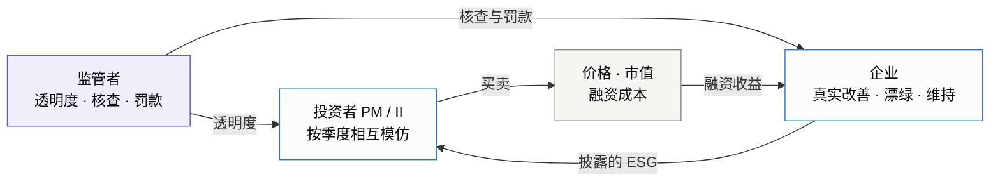

<p align="center">
  
</p>

<p align="center">
  <a href="https://github.com/kanzaler123/financial-ABM/actions/workflows/tests.yml"></a>
  <a href="https://github.com/kanzaler123/financial-ABM/actions/workflows/showcase.yml"></a>
</p>

<p align="center">
  <b>调一调监管旋钮，看 200 家企业怎么选：真实改善，还是漂绿？</b><br>
  一个开源的多智能体人工市场：投资者、企业和监管者在其中互动、学习、演化，用来比较现实中没有试过的 ESG 政策。
</p>

<p align="center">
  <a href="https://kanzaler123.github.io/financial-ABM/"><b>在线试玩政策作战台</b></a> ·
  <a href="#快速开始"><b>本地跑起来</b></a> ·
  <a href="#主要发现"><b>主要发现</b></a> ·
  <a href="CONTRIBUTING.md"><b>参与贡献</b></a> ·
  <a href="README.md"><b>English</b></a>
</p>

<p align="center">
  <a href="https://kanzaler123.github.io/financial-ABM/"></a><br>
  <sub>透明度从 0.10 提高到 0.70，橙色（漂绿）企业逐渐变少，接近门槛时消失。这是浏览器里的简化回放，不是研究结果。<a href="https://kanzaler123.github.io/financial-ABM/">打开页面，自己拖动杠杆。</a></sub>
</p>

## 主要发现

在一个事先登记设计的实验中（1770 个模拟市场），以模型假设为条件：

- **看得清比罚得重更有效。** 在测试剂量下，提高透明度比提高定额罚款更能推动企业真实改善。
- **透明度有门槛，但门槛有多陡取决于成本。** 所有企业漂绿成本相同时，超过门槛企业完全停止漂绿；漂绿成本因企业而异时，漂绿随透明度提高逐步减少。继续加罚款的边际效果递减。
- **大企业更爱漂绿**，原因是有上限的罚款相对大市值微不足道，而不是改善成本更高。
- **没有在乎 ESG 的投资者，政策就不起作用。** 去掉影响力投资者的偏好，三种政策都没有效果。

数值、区间和限定条件见下文[阶段 F 发现](#阶段-f-发现)。

> [!NOTE]
> **研究进行中。** 阶段 F 的确认性实验已经完成：结论以模型假设为条件，政策效应的量级依赖未经校准的自然衰减，按区间报告。其余条目标注了证据层级。

## 快速开始

**不用安装：** 打开[在线政策作战台](https://kanzaler123.github.io/financial-ABM/)，拖动杠杆，再点 **复制当前政策的链接**，就能把你看到的结果原样分享出去。

**在本地跑模型**（Python 3.12+，从仓库根目录执行）：

```sh
python -m venv .venv
# Windows: .venv\Scripts\activate    macOS / Linux: source .venv/bin/activate
python -m pip install -c requirements-lock.txt -e ".[plot,research]"
python -m abm.disclosure.experiments --spec configs/disclosure_quickstart_v1.json --output runs/quickstart --workers 2
```

运行约 10–30 秒：在 40 家企业、4 个种子的小市场上比较三种政策（基准、透明度 0.6、比例罚款）。结果在 `runs/quickstart/report.md`（带区间的配对对比）和 `policy_effects.png`。

**改一个参数，看结果怎么变。** 把 [`configs/disclosure_quickstart_v1.json`](configs/disclosure_quickstart_v1.json) 中场景 `I` 的透明度改成 `"transparency": 0.3`，换一个输出目录 `--output runs/quickstart_tau03` 再跑一次。此时透明度低于门槛：信息政策相对基准的提升从约 +0.37 SD 降到约 +0.07 SD，罚款反而更有效。快速示例使用仓库自带、未经校准的 ESG 领域和小规模市场，用来演示流程，不复现阶段 F。

开发者：`python -m pip install -c requirements-lock.txt -e ".[all,dev]"`，然后 `python -m pytest`。单资产主应用的界面和其他命令见下文[单资产主应用的本地界面](#单资产主应用的本地界面)和 [OPERATIONS.md](OPERATIONS.md)。

## 在这个项目上做研究

- **换一个领域，只需一份 JSON。** “真实属性 vs 披露属性”的信号博弈不只出现在 ESG 中：复制 [`configs/domains/esg.json`](configs/domains/esg.json)，就可以研究碳排放声明、盈余管理或 AI-washing。
- **新的政策实验是一份配置。** 复制快速示例的配置，增加场景和配对比较，运行器会输出带区间的报告。
- **从小处开始。** [CONTRIBUTING.md](CONTRIBUTING.md) 说明环境、研究规则和入手点；标记为 [`good first issue`](https://github.com/kanzaler123/financial-ABM/labels/good%20first%20issue) 的议题适合第一次参与。
- **引用**：见 [CITATION.cff](CITATION.cff)。

## 研究问题

ESG 研究大多用历史数据检验相关性：ESG 好的公司收益更高吗？融资更便宜吗？这类“向后看”的方法很难回答**转型是怎样发生的**，也无法比较现实中没有发生过的政策。

本项目换一种做法：构建一个人工金融市场，让异质的投资者和企业在其中互动、学习、演化，再把政策作为可控变量放进去，做现实中做不了的反事实实验。核心问题是：

> **在政策与市场的双轮驱动下，ESG 转型的效率和路径是怎样的？**

1. **哪种政策更有效？** 提高透明度的“信息型”政策，与提高违规成本的“惩罚型”政策，在事先固定的剂量下比较：透明度从 0.1 提高到 0.6，定额罚款从 1000 万元提高到 4 倍，另有各自的剂量梯度。两种剂量没有按期望罚金或实施成本匹配，所以比较的是这些剂量下的排序，不是同等成本下哪种政策更优。
2. **市场自身的动力有多大？** 在没有外部干预时，影响力投资者能否通过“用脚投票”自发推动转型？政策是放大还是替代了这股力量？
3. **大企业和小企业有什么不同？** ESG 规范在不同规模企业之间的传导速度，是否存在“ESG 鸿沟”？
4. **什么时候会陷入漂绿陷阱？** 在参数空间中画出相图，区分“转型成功”“转型失败”和“漂绿陷阱”。

## 多智能体设计



| 参与者 | 规模 | 行为 |
|---|---|---|
| **利润导向投资者（PM）** | 1000 名投资者中的一部分 | 均值—方差配置，ESG 不进入效用 |
| **影响力投资者（II）** | 同上 | 效用中加入对披露 ESG 的偏好；两类投资者按相对业绩相互模仿，占比随时间演化 |
| **企业** | 200 家，分大、中、小三档 | 每个决策期在“真实改善 / 漂绿 / 维持”中选择：真实改善昂贵且有实施延迟；漂绿便宜、见效快，但可能被核查发现。支持 NPV 理性决策和 Q-learning 学习两种模式 |
| **监管者** | 1 | 设定透明度、核查概率、罚款和补贴，政策可以在任意日期切换 |
| **做市商与噪声交易** | — | 多资产准订单簿：价格冲击、随波动变薄的深度，现金与股份逐日守恒 |

**领域可以替换。** “真实属性 vs 披露属性”的信号博弈不只出现在 ESG 中。领域只是一份 JSON 配置，核心代码中不出现任何领域词汇，由测试强制检查。仓库内置 [ESG](configs/domains/esg.json)、[AI-washing](configs/domains/ai_washing.json)、[WBA 社会维度](configs/domains/wba_social_2023.json) 三个领域。

### 博弈论视角

每一层智能体都对应一个经典博弈，可以先写出均衡基准，再用仿真检验会学习、有限理性的智能体能否到达均衡，以及在哪里偏离。

| 层面 | 博弈 | 仿真检验什么 |
|---|---|---|
| 企业与监管者 | 检查博弈 | 罚款、核查与透明度的闭式漂绿条件，加入市场反馈后是否仍然成立 |
| 企业与投资者 | 信号博弈 | “漂绿陷阱”是否就是混同均衡；透明度和鉴证能否推向分离均衡 |
| 投资者群体 | 演化博弈（复制动态） | 影响力投资的扩张来自“选择”还是“漂移” |
| 监管者 | 斯塔克伯格博弈 | 定向核查与随机核查的比较 |

## 阶段 F 发现

> 确认性实验（2026-10-15）：59 个场景 × 30 个配对种子（41001–41030），共 1770 个契约规模的世界（1000 名投资者、200 家企业、3500 个交易日）。设计、种子和主要问题在运行前写入[研究契约第 20 节](docs/disclosure_research_contract.md)并提交（`2b08f65`）。企业使用连续 NPV 规则。所有结论都以模型假设为条件。

1. **排序稳健：信息政策 > 惩罚政策 > 基准。** 这是指定剂量下的排序（透明度 0.6 对定额罚款 4 倍），两者没有按期望罚金或实施成本匹配，不能读成“同等成本下信息政策更优”。在自然衰减 0 与 0.2 SD/年两端、两个初始化对照和企业改善成本不随规模变化的“等成本”对照下都成立。阶段 F 之后补跑的探索性检验（[稳健性补充报告](reports/disclosure_robustness_20261018/README.md)）中，真实水平向均值回归、每份虚假报告各罚一笔、企业漂绿成本各不相同三种设定下排序也成立；但在均值回归下，信息政策比惩罚政策只多 +0.003 到 +0.006 SD。
2. **量级是一个区间。** 政策窗口（第 1200–3500 日）内，信息政策使真实水平比基准高 +0.04 到 +0.33 SD，惩罚政策高 +0.005 到 +0.13 SD，信息政策比惩罚政策高 +0.035 到 +0.21 SD。两端对应不作为时每年 0 与 0.2 SD 的自然衰减。这个参数未经校准，确定它需要经过核实的评级面板（计划阶段 H）。这个区间只覆盖统一衰减：在回归速度以华证面板为上界的均值回归下，信息政策比基准高 +0.02 到 +0.03 SD，比惩罚政策高接近 0，都低于区间下端。下面第 3–6 条只有主设定（每年 0.2 SD）的数值，量级属区间上端。
3. **政策只能通过市场偏好起作用。** 影响力投资者的偏好使 14 年全期的真实水平提高 +0.79 SD [+0.74, +0.85]。没有偏好时，企业既不改善也不漂绿，三种政策都没有效果。
4. **透明度有门槛。** 在所有企业漂绿成本相同、真实改善持久的设定下，透明度超过 τ* ≈ 0.57 后漂绿决策完全停止，罚款也随之无关；命题 2 对门槛的预测在 16 个格点上全部成立。但切换前积累、未被查处的虚报不会自动消失。企业漂绿成本不同时，门槛是逐家的，漂绿随透明度逐步下降（τ = 0.6 时仍有 7% 的决策漂绿）；真实水平向均值回归时，门槛升到约 0.8。
5. **定额罚款的边际威慑递减。** 从 0 到 1000 万元，漂绿决策占比从 91% 降到 22%；在一案一罚的记账下，再提高到 2、4、8 倍，只降到 16%、13%、13%，因为已有未查处案件的企业，新虚报并入旧案，不面对新的定额罚款。若每份虚假报告各罚一笔，8 倍罚款下降到 0.8%，每次加倍的效果仍然递减。
6. **规模鸿沟来自漂绿，而不是成本。** 基准政策下大企业的漂绿占比为 66%，小企业为 6%，真实变化少 0.33 SD：1000 万元罚款相对大企业的市值微不足道。比例罚消除的是“大企业比小企业更倾向漂绿”的规模关系，不是漂绿本身：比例罚 1× 下大企业仍有 72% 的决策是漂绿，小企业为 88%，总体 84%。在“等额参照”下，比例罚总体远弱于定额罚（真实变化差 −0.34 SD）。

**限制。** 只研究 NPV 企业，学习型企业没有通过阶段 D 的验收；核查强度、定向核查和政策的实施成本都没有建模；37 个运行有价格截断，保留在统计中，剔除后结论不变。完整表格见[阶段 F 报告](reports/disclosure_stage_f_20261014/README.md)。

**浏览器政策沙盘。** [`showcase/`](showcase/README.md) 把企业决策层搬进浏览器。首页默认英文，一键切换中文，打开就是浅色的漂绿政策作战台：顶部是阶段 F 的要点和事件流，左侧是政策杠杆，中间是 200 家合成企业组成的企业球，右侧是单家企业的决策单，下方是智能体卡片（监管者、三档规模的企业、投资者、门槛 τ*）、决策频谱和核查日志。作战台回放的是面板 ②：没有市场反馈的 14 年简化动态，标注为非研究结果。再往下，面板 ① 展示所选政策下 200 家企业这一期会怎样选择，面板 ③ 展示上面的阶段 F 结果并附出处。决策规则与 Python 模型逐项一致（1200 组随机输入，相对误差不超过 10⁻¹²），简化动态与完整模型的差距写在页面上。可以切换到 AI-washing 领域，演示同一机制换一个领域。页面地址会记录当前政策和所选企业，复制链接即可让别人打开同一个作战台。阶段 1 展厅（`stage1/`）使用同一套浅色风格。在线访问：[https://kanzaler123.github.io/financial-ABM/](https://kanzaler123.github.io/financial-ABM/)；本地预览见[单资产主应用的本地界面](#单资产主应用的本地界面)末尾。

<details>
<summary><b>早期诊断（阶段 B 之前）</b></summary>

证据层级：**[事实]** 已核对原文的法规或数据 · **[诊断]** 对模型行为的可复核分析 · **[开发观察]** 小规模、少种子的结果 · **[待查]** 已发现、尚未查清的问题

- **[事实] 法定罚款对大公司几乎没有分量。** 《证券法》第 197 条第二款对虚假披露最多罚 1000 万元，只相当于沪深 300 市值中位数公司的约 0.01%。可持续发展报告指引对违规只规定纪律处分，没有罚款。（ESG 漂绿能否适用该条款尚不明确。）[证据表](docs/disclosure_empirical_magnitudes_20261012.md)
- **[诊断] 开发实验中企业从不漂绿，原因找到了。** 模型里的预期罚金是漂绿收益的 14.5 倍（中位数）；按经验量级换算，模型罚款约为法定上限的 50 倍，融资收益偏小 10–30 倍。如果去掉罚金，漂绿在每一次决策中都比真实改善更划算。[诊断报告](reports/disclosure_wash_diagnosis_20261012/README.md)
- **[诊断] 透明度门槛是“全有或全无”的。** 没有罚金时，透明度低于约 0.565，所有企业都选择漂绿；高于它，则全部转向真实改善。这来自同质的贴现和时间结构，正式实验需要处理这一点。后来已检验（契约第 20.21 条 W 组）：企业漂绿成本不同时，变成渐进下降。
- **[开发观察] ESG 偏好投资者会推动真实改善。** 在三种初始化设定下，市场偏好效应都为正，测量窗口内约 +1.7 到 +2.5 个评分点（3 个种子，区间较宽）。[比较报告](reports/disclosure_csi300_variants_20261012/README.md)
- **[诊断，阶段 C 已修正] 零偏好时影响力投资者占比仍会上升，原因在模仿规则。** 原规则缺少随机抽取比较对象这一步；按 Schlag 的原意修正后，零偏好时没有漂移。[阶段 C 报告](reports/disclosure_imitation_diagnosis_20261013/README.md)

</details>

## 路线图

- [x] **地基：单资产人工市场（Stage 1）**：冻结 v15 正式验收 22/22（见下文）
- [x] **多资产市场**：60 个固定世界审计 57 PASS / 3 FAIL（失败保留记录）；订单流重放 60/60 逐字节复现
- [x] **经验起点**：沪深 300 的 ESG 评分、半年报账面权益、市值三项都是 300/300；校准初始分布、规模相关和价值离散度
- [x] **漂绿条件诊断与经验量级检索**
- [x] **企业博弈**：定额罚款（对应法定上限）与检查博弈的两个命题（阶段 B）
- [x] **投资者演化**：以复制动态为基准修正模仿规则（阶段 C）
- [x] **强化学习企业**：已比较，学习型企业未通过验收，不进入正式实验（阶段 D）
- [ ] **新智能体**：基于风险的监管者、鉴证方与评级分歧
- [x] **正式实验**：信息型 vs 惩罚型、相图、规模鸿沟，按正式规模、用新种子、对比事先冻结（阶段 F）
- [x] **浏览器政策沙盘**：[GitHub Pages](https://kanzaler123.github.io/financial-ABM/)，v0.2.0（2026-10-16）；改版为浅色政策作战台，默认英文（2026-10-18）

详细计划与验收标准见[现行计划](docs/plan_20261013.md)。

## 研究性与可复现

- **设定先于结果。** 关键设定（初始化方式、罚款含义、融资溢价目标）在运行任何政策实验之前写入[研究契约](docs/disclosure_research_contract.md)，不为得到预期的政策排序而调参。
- **失败不删除。** 机械门槛失败、中断的运行和诊断都原样保留。
- **证据可核对。** 研究证据目录按原始字节存储，报告中记录的 SHA-256 可以直接核对；重放和插桩诊断都与归档结果逐位比对。
- **参数有出处。** 每个经验参数都在[证据表](docs/disclosure_empirical_magnitudes_20261012.md)中标注来源和可信度（原文 / 摘要 / 二手）。
- **数据边界。** 华证、东方财富等供应商数据没有开放再分发许可，不放入仓库；采集脚本和 hash 清单保留，可以重新取数逐项核对。

## 地基：单资产人工市场（Stage 1–3）

在加入 ESG 之前，项目先验证人工市场能否再现真实市场的典型事实（厚尾、波动聚集等），这也是申请书设定的硬性节点。

> [!IMPORTANT]
> **Stage 1 冻结版本 v15 正式验收 22/22；Stage 2 合成机制与工程验收通过。**
> v15 于 2026-09-26 使用 50 个新种子 × 16 场景完成 800 次正式仿真。验收对应[冻结源码](reports/stage1_iter6_20260926/frozen_stage1_source.zip)；代码 CI 不替代模型验收，Stage 2 的结果也不等于真实市场校准。

| 实验 | 归档检查 | 用途与边界 |
|---|---:|---|
| [开发实验 v14](reports/stage1_structural_dev_v14_20260814/mechanism_report.md) | **22 / 22** | 开发诊断，不决定阶段完成 |
| [未见种子 holdout v13](reports/stage1_structural_holdout_v13_20260814/mechanism_report.md) | **22 / 22** | 留出种子验证，不替代正式验收 |
| [正式验收 v13](reports/stage1_mechanism_acceptance_v13_20260814/mechanism_report.md) | **18 / 22** | 50 种子 × 16 场景；当时 Stage 1 未完成 |
| [正式验收 v14](reports/stage1_iter5_20260926/formal/mechanism_report.md) | **20 / 22** | 第五轮冻结正式验收；仍未通过 |
| [开发实验 v15](reports/stage1_iter6_20260926/development/mechanism_report.md) | **22 / 22** | 20 种子 × 16 场景；开发诊断 |
| [未见种子 holdout v15](reports/stage1_iter6_20260926/holdout/mechanism_report.md) | **22 / 22** | 10 种子 × 16 场景；留出验证 |
| [正式验收 v15](reports/stage1_iter6_20260926/formal/mechanism_report.md) | **22 / 22** | 50 种子 × 16 场景；[正式决策](reports/stage1_iter6_20260926/formal/final_decision.json) |

历史 v13 未通过的四项是**不依赖价格截断、波动聚集与衰减、厚尾稳定性、内生流动性对尾部的贡献**，当时的结论见 [final_decision.json](reports/stage1_mechanism_acceptance_v13_20260814/final_decision.json)。v15 的预注册、源码归档和机制分析见[第六轮报告](reports/stage1_iter6_20260926/analysis.md)，Stage 2 的边界与证据见[二阶段报告](reports/stage2_20260926/analysis.md)。

<details>
<summary><b>单资产主应用的能力与边界</b></summary>

| 模块 | 已有能力 |
|---|---|
| 价格形成 | 聚合型准订单簿，深度、价差、永久 / 暂时冲击和双信息通道 |
| 账户与审计 | 现金 / 股份守恒，持仓约束，配置与版本记录，逐日审计 |
| 策略实验 | value / trend / noise，固定人口基线；Logit 学习作为单独场景 |
| 机制验证 | 多种子消融、配对对照、预热期、检查点与冻结机制 |
| Stage 2 | 信息图传播、投资者 Bandit、企业表格 Q-learning；合成五节点与 1000 人试跑 |
| Stage 3 | 真实 SEC 8-K 快照、按会话截止时间进入的信息因子、归档重建、情景比较与 PNG/SVG 动画/数据导出；[验证与限制](reports/stage3_20261003/analysis.md) |
| 观察界面 | 本地 Web / 桌面 live、replay、batch；独立的 [GitHub 交互展厅](showcase/README.md) |

主应用的 Web / 桌面界面仍使用单资产市场；多资产披露研究是独立的子包 [`src/abm/disclosure`](src/abm/disclosure)。当前不提供逐笔连续限价订单簿、已校准的真实投资者社交网络、真实交易或公网仿真服务。主应用路线见[三阶段开发计划](docs/ABM三阶段开发计划_渐进式学习版.md)。

</details>

## 单资产主应用的本地界面

```sh
cd web
npm ci
npm run build
cd ..
abm-web --open
```

[OPERATIONS.md](OPERATIONS.md) 提供本地运行、Stage 2 配置、回放和验收复现的详细说明。

<details>
<summary><b>只预览 GitHub 展厅，不安装模型依赖</b></summary>

```sh
python showcase/build.py --output _site
python -m http.server 8080 --directory _site
```

打开 `http://localhost:8080`，或直接打开 `_site/index.html`。首页是漂绿政策作战台（默认英文，可切换中文），阶段 1 展厅在 `stage1/`，两页使用同一套浅色风格。纯静态、离线可用；没有运行控制按钮冒充后端模拟。线上版本：[https://kanzaler123.github.io/financial-ABM/](https://kanzaler123.github.io/financial-ABM/)，由 **GitHub showcase** 工作流在 master 更新时部署。详见[展示层文档](showcase/README.md)。

</details>

## 导航

[文档索引](docs/README.md) · [现行计划](docs/plan_20261013.md) · [研究契约](docs/disclosure_research_contract.md) · [证据表](docs/disclosure_empirical_magnitudes_20261012.md) · [披露博弈源码](src/abm/disclosure) · [实验报告](reports) · [配置与协议](configs) · [完整操作手册](OPERATIONS.md) · [展示层维护](showcase/README.md)

---

<sub>Financial ABM · Research prototype. 可检查的机制，可追溯的证据。非投资建议。</sub>
